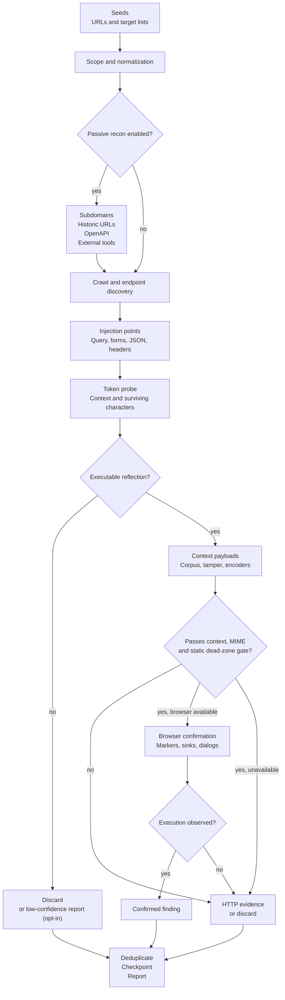
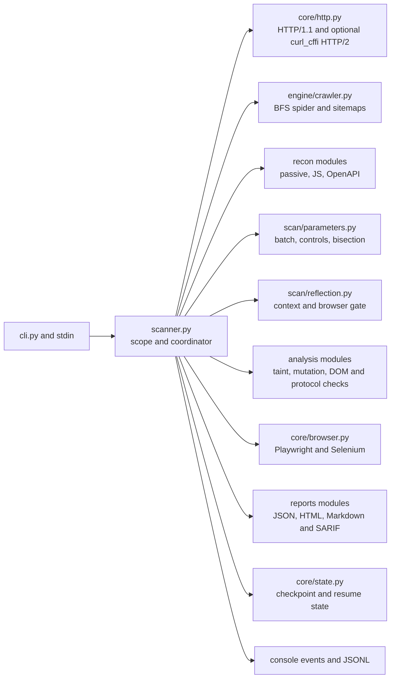

<div align="center">
  
</div>

<h1 align="center">XOXSS</h1>

<div align="center">

**Advanced, persistent, context-aware XSS scanner for authorized security testing.**

[](#requirements)

[](#license)
[](#reports-and-exit-codes)
[](#security-and-legal)

</div>

<br/>

> [!WARNING]
> XOXSS sends attack payloads. Use it only against systems you own or have explicit
> written permission to test. You are responsible for the targets you scan and for the
> data your payloads, callbacks and reports collect.

XOXSS (`xoxss`) is a Python XSS scanner built around one rule: **evidence before
findings**. It probes over HTTP first, classifies the reflection context, and only then
asks a real browser to prove execution. The same engine also covers passive
reconnaissance, JavaScript intelligence, OpenAPI operations, blind XSS through
out-of-band callbacks, prototype pollution, and large URL-list triage.

It is designed for three kinds of work:

- **Manual testing and bug bounty** — crawl a target, find injection points, and get
  browser-confirmed evidence with reproducible payloads.
- **CI and regression checks** — run HTTP-only scans, emit SARIF, and fail a build when
  an actionable finding appears.
- **Large-surface triage** — sweep tens of thousands of URLs in stateless mass mode and
  stream JSONL for downstream processing.

The CLI is the stable interface. `python xoxss.py`, `python -m xoxss` and the installed
`xoxss` command all run the same implementation in `xoxss/scanner.py`.

## Contents

<p align="center">
  <a href="#features">Features</a> •
  <a href="#how-it-works">How it works</a> •
  <a href="#requirements">Requirements</a> •
  <a href="#installation">Installation</a> •
  <a href="#quick-start">Quick start</a> •
  <a href="#cli-reference">CLI reference</a> •
  <a href="#recipes">Recipes</a> •
  <a href="#reports-and-exit-codes">Reports &amp; exit codes</a> •
  <a href="#state-and-resume">State &amp; resume</a> •
  <a href="#configuration">Configuration</a> •
  <a href="#architecture">Architecture</a> •
  <a href="#using-as-a-library">Using as a library</a> •
  <a href="#performance">Performance</a> •
  <a href="#troubleshooting">Troubleshooting</a> •
  <a href="#development">Development</a> •
  <a href="#limitations">Limitations</a> •
  <a href="#security-and-legal">Security &amp; legal</a> •
  <a href="#acknowledgements">Acknowledgements</a> •
  <a href="#license">License</a>
</p>

## Features

**Detection**

- Context-aware payloads for HTML, attributes (double/single/unquoted), `<script>`,
  `<style>`, comments, JSON, `javascript:` URLs and generic fallbacks.
- HTTP-first probing with browser confirmation: Selenium (Firefox, Chrome, Edge) or
  Playwright drives only the candidates that survive the probe stage.
- Execution markers instead of blocking dialogs. Payloads write a random token to
  `window.__xoxss_hits`; `alert`, `confirm` and `prompt` are intercepted and recorded.
- Runtime DOM instrumentation for `innerHTML`, `outerHTML`, `document.write`,
  `insertAdjacentHTML`, `eval`, `setTimeout` and `setInterval`, distinguishing
  *confirmed execution* from *static sink taint*.
- Reflected, stored, header and DOM XSS with an explicit confidence model instead of a
  binary "vulnerable" label.
- Runtime prototype pollution with marker proof, gadget fingerprinting and
  gadget-specific exploit URLs.
- Optional, bounded input-transformation probes for Unicode normalization,
  multi-pass decoding, byte-mask and multibyte behavior; observations can guide
  constraint-driven payload variants without being reported as XSS by themselves.
- Mutation XSS (mXSS) hints from sanitizer and version detection.
- Vulnerable-JavaScript-library detection from URLs and bundle contents.

**Discovery**

- Level-by-level concurrent crawler (`engine/crawler.py`) with depth and URL budgets; parses
  links, forms, iframes, `object`, meta-refresh, `robots.txt`, recursive sitemaps and
  JavaScript.
- JavaScript intelligence: hidden endpoints, parameter names, GraphQL/WebSocket URLs,
  source maps and embedded `sourcesContent`, leaked credential patterns, and
  source-to-sink taint flows with sanitizer awareness. A scope-aware tree-sitter CST
  backend resolves shadowed variables and closures in minified bundles; the regex
  analyzer remains available via `XOXSS_AST_BACKEND=regex`.
- OpenAPI/Swagger discovery, including path parameters and JSON/form request bodies.
- Passive subdomain enumeration (crt.sh, certspotter, HackerTarget, OTX, urlscan) and
  historic URL mining (Wayback, Common Crawl, urlscan, OTX).
- Parameter audit combining collector-style Wayback harvesting with bounded batches
  of unique reflection markers, dynamic controls and response-delta bisection across
  GET query strings, URL-encoded form bodies and JSON POST bodies.
- Multi-header reflection probing: one marker per candidate header in a single request,
  with an executable-payload follow-up only for headers that actually reflect.
- Internal path fuzzing with soft-404 detection, hidden-parameter mining, and parameter
  fuzzing on endpoints that expose no query string.
- Optional orchestration of installed `subfinder`, `gau`, `waybackurls`, `katana`,
  `httpx`, `arjun`, `x8`, `dalfox` and `nuclei` binaries.

**Payloads and evasion**

- Ten context-specific built-in payload families, a rotating remote corpus and the
  bundled 6,900+ entry LazyXss payload pack.
- Eight tamper transforms (`doubleencode`, `hexencode`, `htmlentities`, `jscomment`,
  `jsonfuzz`, `spacetab`, `uppercase`, `urlencode`) and the `all` chain.
- Twenty composable encoders, including entity variants, JS escapes, `fromCharCode`,
  base64/eval, comment breaks, `%uXXXX`, UTF-16LE, full-width characters and null bytes.
- Remote payload lists download to temporary storage and are cleaned up automatically,
  with graceful fallback when offline. Local corpora load from files, JSON arrays or
  whole directories.

**Out-of-band confirmation**

- Blind XSS injections that phone home with a marker, page URL and cookies.
- Native interactsh client with RSA-OAEP/AES-CTR encryption and correlation IDs.
- Generic JSON/NDJSON poller (XSS Hunter, Burp bridges, custom collectors) and a local
  file tailer for `interactsh-client` output.
- Background polling raises a `Blind XSS (callback confirmed)` finding only when the
  out-of-band callback is observed with the marker — a probe that was merely sent is
  never a finding — plus a post-scan grace period for late callbacks.

**Operations and reporting**

- `--god` / `--yolo` full-automatic preset — see [Recipes](#recipes).
- Persistent checkpoints, resume, and cross-run finding deduplication.
- WAF fingerprinting (header/cookie/body signatures) and an active blocking probe.
- Retries with exponential backoff, `Retry-After` support, token-bucket rate limiting,
  optional adaptive (`--smart-rate`) limiting, proxy support and request concurrency.
- Console, JSON, Markdown, self-contained HTML and SARIF v2.1.0 reports.
- Optional browser screenshots for confirmed findings; preflight diagnostics with
  `--doctor`.

## How it works



1. **Scope and discovery.** The target is normalized (`http://` is assumed for bare
   domains). Optional passive recon and external-tool seeds run before the same-origin
   crawl. Destructive paths (`logout`, `delete`, `unsubscribe`, …) and binary assets are
   skipped.
2. **Injection points.** Query parameters, GET/POST form fields, query-bearing links,
   OpenAPI parameters and fuzzed parameter names all become `InjectionPoint` objects
   with a method, parameter, page URL and optional JSON body.
3. **Probe.** A unique token plus special characters is sent. The response is aligned
   with the sent payload to determine the context and whether `<`, `>`, quotes, `=` and
   parentheses survived. Optional `--mutation-probes` measures bounded normalization
   and decoding behavior; `--adaptive-payloads` adds variants from observed constraints.
4. **Payload selection.** Context-specific templates are rendered with a second unique
   marker; a controlled share of slots comes from the remote corpus, local corpora fill
   the rest.
5. **HTTP evidence.** If a payload is reflected unescaped, the finding is `high`
   confidence when browser verification is unavailable or inconclusive.
6. **Browser confirmation.** Candidates must pass the context, MIME and static
   dead-zone gate before browser work. GET points are navigated; forms are filled and submitted.
   The scanner checks `window.__xoxss_hits`, intercepted dialogs and instrumented
   sinks. Execution upgrades the finding to `confirmed`.
7. **Persistence and reporting.** Findings are deduplicated by family, URL, parameter,
   method and optional subkey, then written to the checkpoint and every requested
   report format.

Confidence model (drives `--fail-on-findings` and SARIF severity):

| Confidence | Meaning |
|---|---|
| `confirmed` | The marker executed or produced an observed dialog in a browser, or an out-of-band callback answered with the blind-XSS marker. |
| `high` | Payload reflected unescaped in an executable context (browser verification unavailable), or a payload persisted and re-rendered for stored XSS. |
| `medium` | Header reflection that survived unescaped and executable (browser verification needs a proxy, so it stays below `high`). |
| `low` | Reflected but not executable, a static DOM candidate, an un-verified external-tool claim, or a DOM sink that was reached without executing. Usually requires `--report-reflections` for the reflection case. |

**Evidence policy.** A finding is only raised on real evidence: the payload
survived unescaped in an executable context, executed in a browser, was
persisted and re-rendered, or its out-of-band marker was answered. A blind
probe that was merely *sent* never produces a finding; polyglot payloads must
be executable, not just reflected; header injections must be executable; and
third-party tools (`dalfox`/`nuclei`) ship as `low` + `unverified` because
XOXSS did not confirm them itself. Every finding carries a reproduction proof:
`poc_url` (a ready-to-open URL for GET injection points) or `poc_command` (a
`curl` one-liner for POST / header / cookie points). The PoC embeds only the
injected parameter — no cookies or session data.

## Requirements

| Component | Required | Notes |
|---|---|---|
| Python | **3.9+** | CI covers 3.9 through 3.13. |
| `aiohttp` | Yes | HTTP engine, concurrency, retries. |
| `aiodns` | Yes | Asynchronous DNS on supported event loops; threaded resolver fallback elsewhere. |
| `beautifulsoup4` | Yes | HTML parsing and form extraction. |
| `selenium` + `webdriver-manager` | For browser mode | Drivers resolve via Selenium Manager first, then webdriver-manager. |
| Firefox / Chrome / Edge | For Selenium mode | Use `--no-browser` for HTTP-only operation. |
| Playwright | Optional | `--browser playwright`; requires `playwright install chromium`. |
| `cryptography` | Optional | Native `--interactsh` decryption. |
| `curl_cffi` | Optional | `--http2` multiplexing and `--impersonate` TLS fingerprints (`pip install "xoxss[http2]"`). |
| `tree-sitter` + `tree-sitter-javascript` | Optional | Scope-aware CST taint backend (`pip install "xoxss[ast]"`); the regex analyzer remains the fallback. |
| `uvloop` | Optional | Faster event loop on non-Windows platforms. |
| External binaries | Optional | `subfinder`, `gau`, `waybackurls`, `katana`, `httpx`, `arjun`, `x8`, `dalfox`, `nuclei`; missing tools contribute nothing. |

Linux, macOS and Windows are supported. On Windows, `uvloop` is skipped and Selenium
Manager resolves the browser driver. The scanner degrades to HTTP-only mode when no
browser is available.

## Installation

```bash
git clone https://github.com/gl1tch0x1/xoxss.git
cd xoxss

# install the package and the `xoxss` console script
pip install .

# or an editable development install
pip install -e ".[dev]"

# runtime dependencies only, without packaging
pip install -r requirements.txt
```

Optional extras:

```bash
pip install ".[interactsh]"        # native interactsh client
pip install ".[playwright]"        # Playwright backend, then: playwright install chromium
```

### Automated setup and updates

The repository ships two helper scripts for hands-off setup and maintenance.
Both run every pip call through the interpreter that started them
(`sys.executable -m pip`), so they are safe inside virtual environments.

```bash
# interactive installer: installs the package, then asks about each optional extra
python installer.py

# non-interactive: installs everything, optional extras included
python installer.py -y

# skip the extras, or only verify prerequisites and current state
python installer.py --no-extras
python installer.py --check

# update an existing git clone: fetch, fast-forward, refresh the install
python updater.py

# report whether an update is available, without changing anything
python updater.py --check

# local changes are temporarily stashed, restored after updating, and extras refreshed
python updater.py -y
python updater.py -y --extras interactsh,playwright

# opt out of automatic local-change preservation
python updater.py --no-auto-stash
```

The installer refuses to run outside a repository checkout and falls back to
the core scanner even when an optional extra fails. The updater never rewrites
history — it temporarily stashes tracked and untracked local changes, fast-forwards
with `git pull --ff-only`, then restores the changes. If restoration conflicts, the
stash is kept and the updater asks you to resolve the conflict. Use `--no-auto-stash`
to make a dirty checkout stop before updating.

The bundled Docker image is intentionally HTTP-only: no browser, no external scanners,
non-root user — suitable for reflection checks in CI:

```bash
docker build -t xoxss .
docker run --rm -v xoxss-data:/data xoxss https://target.tld/?q=1 \
  --no-browser --no-state --no-remote-payloads --state-dir /data --report-dir /data/reports
```

Verify the installation (exits non-zero only when a required component is missing):

```bash
xoxss --doctor
xoxss --doctor --no-browser     # HTTP-only deployment
```

`--doctor` also reports `DISPLAY`/`WAYLAND_DISPLAY` and whether a system
Chromium/Chrome binary was autodetected. XOXSS checks `XOXSS_CHROMIUM`,
`CHROME_BIN`, common Linux/macOS paths (`/usr/bin/chromium`,
`/usr/bin/google-chrome`, snap paths, …) and the Windows install
directories before asking Selenium Manager to download a driver. Headed mode
needs a display; on a bare Linux host either pass `--headless` or wrap the
command:

```bash
xvfb-run -a xoxss https://target.tld --show-browser --deep
```

Windows notes: `uvloop` is not installed there (standard asyncio is used); quote
cookies/headers in PowerShell (`--cookies "session=abc; theme=dark"`); Selenium Manager
normally downloads the correct driver, otherwise use `--binary` for the browser
executable.

## Quick start

```bash
# 0. God mode: everything below, fully automatic, no extra flags
xoxss example.com --god          # alias: --yolo

# 1. Fast HTTP-only triage of a single URL
xoxss "https://target.tld/?q=1" --no-browser --report json,sarif

# 2. Harvest a domain and find reflecting parameters (collector + Gxss)
xoxss example.com --param-audit --param-output params.json

# 3. Crawl, confirm in a headless browser, save evidence
xoxss https://target.tld --crawl --deep \
  --browser playwright --headless --screenshot --report all

# 4. Triage a large URL list without a browser
xoxss -l urls.txt --mass --jsonl findings.jsonl --concurrency 32
```

A confirmed finding is printed with its URL, parameter, method, payload, context and
evidence. JSON, Markdown, HTML and SARIF files are written to `.xoxss/reports/` by
default, with a `-latest` copy for each format.

Run `xoxss --help` for the authoritative generated reference.

## CLI reference

Use `--profile quick` for a short HTTP-only pass with local payloads, `--profile balanced`
for the normal defaults, or `--profile deep` to enable the deep crawl preset. Explicit
CLI flags take precedence over quick-profile defaults. Response bodies are capped at
5 MiB by default; tune `--max-response-bytes N` for applications that return unusually
large pages. Truncated bodies are reported in scan statistics and reports.

### Targets and discovery

| Option | Description |
|---|---|
| `TARGET ...` | One or more URLs or bare domains. Bare domains get `http://`. |
| `-l, --target-list PATH` | File with one target per line (# comments ignored). |

When no target or target list is supplied, XOXSS reads one URL per line from piped
standard input. For example: `httpx -silent -l hosts.txt | python -m xoxss --mass --jsonl findings.jsonl`.
| `--crawl` / `--deep` | Crawl before scanning / deep preset (depth ≥ 5, ≥ 1500 URLs, discovery, path probing, parameter fuzzing). |
| `--crawl-depth N` / `--max-urls N` | Crawl depth (default `3`) and scan budget (default `500`). |
| `--discover` / `--discover-paths` | Parse robots.txt, sitemaps and JavaScript (on by default) / probe 41 common endpoint paths. |
| `--endpoint-wordlist PATH` | Extra paths for `--discover-paths`. |
| `--js-files N` | Maximum JavaScript files parsed per scan (default `25`). |
| `--fuzz-params` / `--fuzz-param-limit N` | Append common parameter names to parameterless endpoints (default off, 10 names). |
| `--subdomains` / `--subdomain-brute N` | Passive subdomain enumeration / also resolve the first N brute-force candidates. |
| `--passive-urls` | Mine Wayback, Common Crawl, urlscan and OTX for historic URLs. |
| `--openapi` | Discover OpenAPI/Swagger documents and expand their operations. |
| `--fuzz-paths` | Run the internal soft-404-aware path fuzzer. |
| `--mine-params` | Probe high-signal parameter names and keep ones that affect the response. |
| `--external-tools` | Use installed external recon/verification binaries. |
| `--allow-subdomains` / `--include REGEX` / `--exclude REGEX` | Scope control; subdomains are auto-enabled for recon. |

### Injection and payloads

| Option | Description |
|---|---|
| `--max-payloads N` | Payloads per injection point (default `6`). |
| `--payload-file PATH` / `--payload-dir DIR` | Custom corpus: single file, `os.pathsep`-separated list, JSON array / recursive directory. |
| `--lazy-payloads` / `--remote-payloads` | Bundled LazyXss pack (on) / temporary GitHub corpus download (on). Disable with the `--no-*` form. |
| `--payload-source URL` / `--payload-limit N` | Extra raw payload URL / maximum remote payloads kept (default `600`, hard cap `5000`). |
| `--payload-tmp-dir DIR` / `--keep-payloads` | Payload cache root / retain the temp directory after the scan. |
| `--tamper NAME` | `doubleencode`, `hexencode`, `htmlentities`, `jscomment`, `jsonfuzz`, `spacetab`, `uppercase`, `urlencode`, `all`. |
| `--encoder NAME` | Encoder-registry transform, repeatable (see `--list-encoders`). |
| `--scan-headers` / `--header-list H ...` | Test header reflection with a curated default set. |
| `--dom` / `--stored` / `--stored-pages N` | DOM analysis (on) / persisted-payload hunting after POSTs (10 pages). |
| `--report-reflections` | Also report non-executable reflections and static DOM candidates. |
| `--check-libs` | JavaScript library vulnerability detection (on). |
| `--blind CALLBACK_URL` | Inject out-of-band blind-XSS probes into every injection point. |

### Analyzers

| Option | Description |
|---|---|
| `--jsonp` | Detect and test JSONP callback endpoints. |
| `--csp-analyze` | CSP bypass opportunities. |
| `--cors-analyze` | CORS misconfigurations. |
| `--mxss` | Mutation XSS heuristics from sanitizer/version detection. |
| `--proto-pollution` | Runtime prototype-pollution proof, gadget fingerprinting, gadget URLs. |
| `--polyglot` | Polyglot payloads for faster coverage. |
| `--per-char-probe` | Per-character probing for precise context detection. |
| `--smart-rate` | Adaptive rate limiting instead of a fixed token bucket. |
| `--dom-clobbering` | DOM clobbering analysis. |
| `--trusted-types` | Trusted Types CSP analysis. |
| `--graphql` | GraphQL endpoint detection and introspection exposure. |
| `--websocket` | WebSocket sink analysis (`onmessage`/`eval` flows). |
| `--ws-active` | Actively inject marker frames into WebSocket endpoints discovered in page JavaScript (requires `--websocket`). Frame reflections are reported conservatively; they still require handler verification. |
| `--file-upload` | File upload form discovery. |
| `--postmessage` | `postMessage` handler analysis (origin validation). |

### Out-of-band confirmation

| Option | Description |
|---|---|
| `--interactsh [SERVER]` | Register with an interactsh server (default `oast.pro`) and poll it. |
| `--oob-poll URL` | Poll a JSON/NDJSON collector endpoint for markers. |
| `--oob-file PATH` | Tail a local JSON-lines/text collector file (needs `--blind` or `--interactsh`). |
| `--oob-interval S` / `--oob-wait S` | Poll cadence / post-scan grace period for late callbacks. |

### Browser verification

| Option | Description |
|---|---|
| `--browser {firefox,chrome,chromium,edge,playwright}` | Backend (default `firefox`). |
| `--headless` | Force headless. When omitted, XOXSS runs headed on an interactive terminal and headless under CI, pipes or a missing display. |
| `--show-browser` | Force a visible (headed) window; ignored if `--headless` is also given. |
| `--browser-workers N` | Parallel engine instances (default `1`). |
| `--confirm {auto,browser,http}` | Strategy (default `auto` — uses the browser when available). |
| `--screenshot` / `--binary PATH` | Evidence screenshots / explicit browser executable. Browser-confirmed findings always save a screenshot, even without `--screenshot`. |
| `--no-browser` | HTTP-only mode; sets `--confirm http`. |
| `--user-agent STRING` | UA override for HTTP and browser sessions. |

### Network, authentication and output

| Option | Description |
|---|---|
| `--threads N` / `--concurrency N` | URL workers (default `10`) / parallel requests (default `16`). |
| `--timeout S` / `--retries N` | Per-request timeout (default `20`) / retries (default `2`). |
| `--rate-limit N` | Global requests-per-second cap; `0` is unlimited. |
| `--proxy URL` / `--insecure` | HTTP(S) proxy / disable TLS verification (authorized targets only). |
| `--http2` | Multiplex requests over HTTP/2 through the optional `curl_cffi` transport; degrades to aiohttp HTTP/1.1 when unavailable. |
| `--impersonate PROFILE` | Emulate a browser TLS/JA3/JA4 fingerprint (for example `chrome124`, `firefox133`); implies the curl transport. |
| `--max-response-bytes N` | Maximum response body size analyzed (default `5242880`). |
| `--headers "Name: Value"` / `--cookies "a=b; c=d"` | Extra headers and cookies for HTTP probes. |
| `--auth-state PATH` | Playwright storage-state JSON for browser discovery/verification and scoped HTTP cookies. |
| `--mutation-probes` / `--mutation-probe-limit N` | Opt in to bounded Unicode, decoding, byte-mask and multibyte transformation probes. |
| `--adaptive-payloads` | Add bounded syntax variants using observed delimiter constraints. |
| `-o, --output PATH` | Mirror the console log to a file. |
| `--report LIST` | `json`, `md`, `html`, `sarif`, combinations, `all`, or `none` (default `all`). |
| `--report-dir DIR` / `--state-dir DIR` | Report root / checkpoint root (default `.xoxss`). |
| `--events-jsonl PATH` | Append versioned JSONL target, discovery, finding, and completion events for automation. |
| `--no-state` / `--no-resume` | Disable checkpoints / reset and start over. |
| `--verbose` / `--quiet` / `--no-color` | Debug output / findings-only / disable ANSI colours. |
| `--fail-on-findings` | Exit `2` when confirmed/high findings exist. |
| `--replay FINDING_ID` | Re-run one finding from a previous JSON report: one request plus one browser check. |
| `--replay-report PATH` | JSON report to load for `--replay` (default: newest `*.json` in `--report-dir`). |
| `--doctor` / `--list-payloads` / `--list-tampers` / `--list-encoders` / `--version` | Diagnostics and registry inspection. |

> [!NOTE]
> `--headers` and `--cookies` apply to HTTP requests. Use `--auth-state` to provide
> Playwright cookies to browser and HTTP sessions. Cross-origin redirects are stopped to keep credentials and scan traffic
> on the original origin; redirects are still checked against the configured scope.

### Mass mode

`--mass` is a stateless HTTP sweep: no crawl, browser, checkpoint, OOB or automatic
reports. Existing parameters are rewritten one at a time; URLs without a query string
get `--mass-params "q,search,..."` fallbacks, and each parameter gets
`--mass-payloads N` (default `4`) payloads plus local-corpus slots. Tamper and encoder
transforms apply per request. Only executable reflections are emitted, as
`Reflected XSS (HTTP evidence)` with `confidence: high`. `--jsonl PATH` appends one
finding object per line for streaming ingestion.

When no target argument or `--target-list` is provided, xoxss reads one URL per
line from piped standard input. Blank lines and lines beginning with `#` are ignored:

```bash
subfinder -d example.com -silent | httpx -silent | python -m xoxss --mass --jsonl findings.jsonl
```

### Parameter audit (collector + Gxss)

`--param-audit` is a standalone reconnaissance mode that harvests historic URLs the way
`collector` does, extracts unique parameter names, and probes bounded batches of
unique markers with dynamic controls and response-delta bisection. GET query strings,
URL-encoded form bodies and JSON POST bodies all use the same batched workflow: two
benign controls, one marker per field, then delta bisection. It does not crawl, launch a
browser, download payloads, or create a checkpoint.

| Option | Description |
|---|---|
| `--param-audit` | Run the harvest and reflection audit, then exit. |
| `--param-input PATH` | Read seed URLs from a file; skips Wayback harvesting when used alone. |
| `--param-source {wayback,passive,both,none}` | URL source (default `wayback`, or `none` with `--param-input`). |
| `--param-subs` / `--param-limit N` | Include subdomains in harvesting (on) / maximum URLs (default `5000`). |
| `--param-max-checks N` | Maximum parameter names to probe (default `10000`). |
| `--param-marker STRING` | Alphanumeric marker prefix (default `XoxssReflect`). |
| `--param-batch-size N` | Unique markers per GET, form or JSON request (default `100`, maximum `100`). |
| `--param-data BODY` | POST form body or JSON object, e.g. `user=test&pass=test` or `{"user":"test"}`. |
| `--param-output PATH` / `--jsonl PATH` | JSON audit report / one candidate object per line. |

The audit JSON contains `mode`, `targets`, `source`, `stats`, `errors` and a
`candidates` array (each with `name`, `count`, `risk`, `urls`, `sample_url`, `reflected`,
`context`, `status`, `probe_url`, `evidence` and `executable`). A reflected parameter is
**evidence of reflection, not execution** — `executable` stays `false`; feed
`probe_url`s to `--mass` or the main scanner to test exploitability. `--fail-on-findings`
exits `2` when any parameter reflects.

When Arjun or x8 is installed, the main discovery flow can also add their hidden query
parameter names to the scanner's candidate set. GET, URL-encoded form and JSON POST
reflection probes all batch unique markers and compare against two benign controls.
Response-delta bisection is used when a batch changes the response without reflecting
any marker. Dynamic baselines are recorded so response drift does not become reflection
evidence by itself. Form bodies are grouped by full request URL so query parameters
that influence the endpoint are never mixed across requests.

## Recipes

### God mode (`--god` / `--yolo`)

```bash
xoxss example.com --god
```

Pass one flag, pick your target (URL, bare domain, or `-l targets.txt`) and walk away.
It enables and retries degraded setups automatically:

- **Recon**: passive subdomains, 50 brute-force candidates, `--allow-subdomains`,
  Wayback/Common Crawl/urlscan/OTX URL mining, OpenAPI discovery, parameter mining.
- **Discovery**: crawl depth ≥ 6, ≥ 3000 URLs, 60 JS files, path and parameter fuzzing.
- **Injection**: ≥ 16 payloads per point, ≥ 1500 remote payloads + LazyXss, header
  injection, stored-XSS hunting, reflection reporting.
- **Analyzers**: polyglots, JSONP, prototype pollution, mXSS, CSP/CORS, Trusted Types,
  DOM clobbering, `postMessage`, WebSocket, file-upload and GraphQL detection,
  smart rate limiting.
- **Verification**: fastest browser available (Playwright → Chrome/Edge/Firefox), two
  headless workers, screenshots; HTTP-only without a browser.
- **Blind XSS**: public interactsh (`oast.pro`) unless you supplied `--blind`,
  `--interactsh`, `--oob-poll` or `--oob-file`.
- **External tools**: dalfox/nuclei/subfinder/gau/katana/arjun/x8 when installed.

Networking is raised to 20 workers × 32 concurrent requests, 30 s timeout. Explicit
flags always win (`--god --max-urls 500` keeps the URL budget). Not combinable with
`--mass` or `--param-audit`. Authorized targets only — it is deliberately loud.

### Authenticated scan

```bash
xoxss -l targets.txt \
  --headers "Authorization: Bearer $TOKEN" \
  --cookies "session=$SESSION" \
  --rate-limit 10 --threads 8 \
  --no-browser --report json,html
```

Credentials are visible in the local process list and shell history; prefer a wrapper
that reads secrets from a vault or environment. Browser verification does not inherit
these credentials.

### Blind XSS

```bash
# interactsh: registers, polls and decrypts automatically
xoxss https://target.tld --crawl --interactsh --oob-wait 60 --no-browser

# or a collector you control
xoxss https://target.tld --crawl \
  --blind https://collector.example/collect \
  --oob-poll https://collector.example/hits \
  --oob-file ./interactions.jsonl \
  --oob-wait 30
```

A callback produces a `Blind XSS (callback confirmed)` finding (only a callback —
never the mere act of sending a probe — creates it). The
poller accepts `data`, `hits`, `requests`, `results`, `interactions` or `events`
arrays, a single object, or one interaction per line. Use a self-hosted server with
`--interactsh https://...` when callbacks must stay inside your infrastructure.

### Full discovery

```bash
xoxss https://target.tld \
  --subdomains --subdomain-brute 200 --passive-urls --openapi \
  --fuzz-paths --mine-params --fuzz-params \
  --crawl --crawl-depth 4 --max-urls 1200 \
  --no-browser
```

Reconnaissance is opt-in. Subdomain enumeration widens scope to the registrable
domain; historic-URL collection keeps only in-scope hosts. `--include`/`--exclude`
constrain either result.

### Runtime prototype pollution

```bash
xoxss https://target.tld --proto-pollution \
  --browser playwright --headless --report json,html
```

Probe URLs inject `__proto__`/`constructor[prototype]` spellings in query and fragment,
each with a unique marker. A finding requires the page's own parser or merge code to
pollute `Object.prototype` (verified in the browser). The page is fingerprinted for
jQuery, Vue, Lodash, DOMPurify, Angular, GTM and similar gadgets; gadget-specific
exploit URLs are navigated next and an alert carrying a second marker proves execution.
Unfired gadgets are recorded as low-confidence candidates. Expect six probe page
loads per scanned URL plus gadget attempts; with `--no-browser` only static hints are
logged.

### WAF evasion chain

```bash
xoxss https://target.tld \
  --tamper uppercase --encoder urlencode --encoder js_unicode \
  --max-payloads 12 --rate-limit 5 --no-browser
```

Tamper transforms run first, then the encoder chain. Inspect and enumerate with
`--list-tampers` / `--list-encoders`. Evasion is not guaranteed; reduce the rate and
review blocked requests before increasing payload volume.

### Local payload corpus

```text
payloads/
  xss.txt          # one payload per line, optional "context|payload" prefix
  custom.json      # ["<svg onload=...>", {"payload": "...", "context": "script"}]
```

```bash
xoxss https://target.tld --payload-dir ./payloads \
  --max-payloads 15 --no-remote-payloads --no-browser
```

Valid contexts: `html`, `attr_double`, `attr_single`, `attr_unquoted`, `script`,
`style`, `comment`, `json`, `url`, `generic`. Untagged lines are classified
automatically. The bundled LazyXss list (`xoxss/data/lazyxss.txt`) is enabled by
default and sampled alongside the curated corpus — disable with `--no-lazy-payloads`;
see `xoxss/data/LAZYXSS_NOTICE.md` for provenance.

### CI with SARIF

```yaml
- name: XSS scan
  run: |
    xoxss "$TARGET" --no-browser --no-remote-payloads --no-state \
      --report sarif --report-dir artifacts --fail-on-findings

- name: Upload SARIF
  if: always()
  uses: github/codeql-action/upload-sarif@v3
  with:
    sarif_file: artifacts
```

Only `confirmed` and `high` findings return `2`. There are no open-ended blind
findings waiting to be confirmed — a blind point either has a callback (confirmed)
or nothing at all. For air-gapped environments use
`--no-remote-payloads` and mount a local corpus.

## Reports and exit codes

Each requested format is written as:

```text
<report-dir>/xoxss-<host>-<sha1(target)[:6]>-<YYYYmmdd-HHMMSS>.<ext>
<report-dir>/xoxss-<host>-<sha1(target)[:6]>-latest.<ext>
```

| Format | Ext | Contents |
|---|---|---|
| JSON | `.json` | Full payload: stats, recon, OOB, analyzer results, findings. Each finding includes `finding_id`, the redacted `request`, `response_status`/`response_excerpt`, `sink`/`dom_path`, `oob` callback detail, `poc_url` and a copy-paste `poc_curl`. |
| Markdown | `.md` | Human-readable summary, tables with finding IDs, per-finding request/response evidence, sink, OOB callbacks and a `curl` PoC block. |
| HTML | `.html` | Self-contained dark-theme report with cards, tables, a PoC column, full request/response evidence and click-to-expand screenshot evidence. |
| SARIF | `.sarif` | SARIF v2.1.0 for code-scanning platforms. Rules derive from findings (`xoxss/reflected-xss`, …); `confirmed`/`high` → `error`, `medium` → `warning`, `low` → `note`. Each result embeds `findingId`, `request`, `sink`, `pocUrl`, `pocCurl` and `oob` properties. |

Screenshots go to `<state-dir>/screenshots/` (`<token>.png`, `dom-<token>.png`) and are
linked from findings. The HTML report renders each one as a thumbnail that opens in a
keyboard-accessible lightbox dialog (Escape or a backdrop click closes it). Only images
inside the scanner's screenshot directory are inlined; any other path stays as escaped
text so a report can never embed arbitrary local files. `--jsonl` is mass-mode output only: one finding object per line,
appended across runs.
Full scans can use `--events-jsonl` for live lifecycle and finding events. JSON reports
include verification availability and coverage notes for request failures and truncated
responses, so an empty finding list is easier to interpret.

The JSON report (abridged — the real document also includes per-bundle JS
intelligence, OpenAPI operations, OOB registrations and every analyzer list):

```json
{
  "tool": "XOX$$",
  "version": "2.0.0",
  "target": "https://target.tld/",
  "duration_seconds": 12.34,
  "waf": ["cloudflare"],
  "waf_blocking": false,
  "stats": {
    "requests": 480, "payloads": 120, "points": 40, "findings": 1,
    "urls_total": 12, "urls_done": 12, "browser_checks": 8,
    "endpoints": 37, "subdomains": 14, "passive_urls": 220
  },
  "recon": { "subdomains": [], "passive_urls": [], "js_intel": [] },
  "jsonp_findings": [], "csp_issues": [], "cors_issues": [],
  "proto_pollution_sources": [], "blind_markers": [],
  "findings": [
    {
      "finding_id": "1a2b3c4d5e6f7890",
      "kind": "Reflected XSS (HTTP evidence)",
      "url": "https://target.tld/search?q=...",
      "parameter": "q",
      "method": "GET",
      "payload": "<script>...</script>",
      "evidence": "marker reflected unescaped",
      "confidence": "high",
      "confidence_rationale": "The payload's delimiters survived verbatim in an executable context; browser verification was disabled.",
      "context": "html",
      "source": "query",
      "request": {
        "method": "GET",
        "url": "https://target.tld/search?q=...",
        "headers": {"Cookie": "[REDACTED]", "User-Agent": "..."},
        "body": "",
        "redacted": true
      },
      "response_status": 200,
      "response_excerpt": "...100 chars before<script>...100 chars after...",
      "sink": "",
      "dom_path": "",
      "oob": {},
      "poc_url": "https://target.tld/search?q=<script>...</script>",
      "poc_curl": "curl -sk 'https://target.tld/search?q=%3Cscript%3E...'",
      "poc_command": "",
      "timestamp": "2026-11-03T10:00:00+00:00"
    }
  ]
}
```

Every finding carries a reproduction. `poc_url` is present on GET injection
points as a one-click link; `poc_curl` is always populated as a copy-paste
command for GET, POST, JSON, header and cookie points. Requests are redacted —
cookies, `Authorization` and sensitive form/JSON keys become `[REDACTED]` so a
report can be shared, while the injected parameter is preserved.

### Replaying a finding

```bash
# newest report in --report-dir, match a finding id (prefix is enough)
xoxss --replay 1a2b3c4d --replay-report .xoxss/reports/xoxss-target-latest.json

# or point at the report directory and add a fresh session
xoxss --replay 1a2b3c4d --cookies "session=abc"
```

`--replay` issues exactly one request rebuilt from the finding's stored
`request` (falling back to `poc_curl`), then performs one browser check when a
browser is available. It prints a JSON result (`reflected`, `executable`,
`browser_executed`, `reproduced`) and exits `0` when the finding reproduces.
Redacted credentials are never replayed literally; supply your own session with
`--headers`/`--cookies`.

| Exit code | Meaning |
|---|---|
| `0` | Completed; no actionable findings (or `--fail-on-findings` not set). |
| `1` | Fatal error, missing required dependency, invalid configuration, or `--doctor` failure. |
| `2` | Actionable findings with `--fail-on-findings`, or invalid CLI usage. |
| `130` | Interrupted with Ctrl+C; checkpoints are saved. |

## State and resume

```text
.xoxss/
  state/<host>-<sha1(target)[:12]>.json    # checkpoint: scanned URLs, findings, WAF
  screenshots/<token>.png                  # optional confirmed-finding evidence
  reports/xoxss-<host>-<tag>-<stamp>.<ext> # timestamped + -latest copies
```

The checkpoint is written atomically with `os.replace` after each URL and finding
(debounced — forced at findings, cancel and scan end). Re-running the same target
resumes at the first unscanned URL and deduplicates findings across runs. `--no-state`
disables writes; `--no-resume` resets.

> [!TIP]
> If you significantly change payloads, scope, authentication or crawl settings, run
> with `--no-resume` for a clean pass. Otherwise already-scanned URLs may be skipped.

Temporary remote payloads live in a unique directory under the system temp directory
(or `XOXSS_TMPDIR` / `--payload-tmp-dir`) and are removed in a `finally` block;
`--keep-payloads` retains them.

## Configuration

Configuration is entirely CLI-driven — no implicit project config file, which keeps CI
runs reproducible.

| Variable | Effect |
|---|---|
| `NO_COLOR` | Disable ANSI colour output. |
| `XOXSS_TMPDIR` | Root for the temporary remote payload cache. |

Secret hygiene: prefer a secret manager or shell-expanded environment variables; CLI
arguments can appear in process listings and shell history. Reports may contain URLs,
payloads, callback-echoed cookies and leaked secrets from JavaScript — treat report
directories as sensitive. Blind payloads can exfiltrate cookies to your collector; only
use collectors you control.

## Architecture

The current codebase is split into focused CLI, transport, crawl engine, analysis, recon,
reporting and browser modules. `scanner.py` remains the scan coordinator and target
orchestrator.



The parameter-audit batching path is shared by GET query parameters, URL-encoded form
bodies and JSON POST body properties. The batching path is:

```mermaid
flowchart TD
    C["Ranked parameter candidates"] --> B["Bounded batch<br/>GET, form or JSON<br/>unique marker per name"]
    B --> CTRL["Two benign control responses"]
    CTRL --> DYN{"Baseline dynamic?"}
    DYN --> RESP["Compare batch response<br/>against controls"]
    RESP --> HIT{"Unique marker reflected?"}
    HIT -->|yes| ATTR["Attribute reflection to exact parameter"]
    HIT -->|no| DELTA{"Stable response delta?"]
    DELTA -->|yes| SPLIT["Bisect candidate batch"]
    SPLIT --> B
    DELTA -->|no| MISS["Mark candidates unreflected"]
    DYN -. annotate evidence .-> ATTR
```

```text
xoxss.py                  compatibility entry point for `python xoxss.py`
xoxss/
  scanner.py              scan coordinator, findings and target orchestration
  cli.py                  CLI parser construction
  core/
    http.py               shared asynchronous HTTP transport (aiohttp + optional curl_cffi HTTP/2)
    browser.py            Selenium and Playwright backends
    config.py             typed configuration schema (CLI remains authoritative)
    state.py              crash-safe checkpoint/resume state and URL lifecycle
  engine/
    crawler.py            BFS spider, sitemap walker and endpoint recorder
  detection/
    reflection.py         token alignment, context and surviving-character analysis
    context.py            context classification helpers
    payload.py            blind payload construction
    dom.py                DOM source/sink analysis
    waf.py                WAF signatures and blocking heuristics
    encoders.py           composable encoder registry
  analysis/
    ast_taint.py          JavaScript source-to-sink flow analysis (regex fallback)
    cst_taint.py          scope-aware tree-sitter CST taint backend
    proto_pollution.py    static hints, probes, gadgets, exploit URLs
    mutation_probe.py     bounded response transformation observations
    payload_grammar.py    constraint-driven payload variants
    jsonp.py csp.py cors.py mxss.py
    dom_clobbering.py trusted_types.py graphql.py
    websocket.py file_upload.py postmessage.py
    per_char.py polyglot.py rate_limit.py
  recon/
    subdomains.py         certificate/passive DNS sources
    passive.py            Wayback, Common Crawl, urlscan, OTX
    jsintel.py            bundle endpoints, secrets, source maps, taint
    openapi.py            Swagger/OpenAPI expansion
  oob/
    base.py               OOB manager, marker correlation, generic parsing
    interactsh.py         native RSA/AES interactsh client
    poller.py             HTTP and file pollers
  scan/
    fuzzer.py             path fuzzing, wordlists, parameter mining
    parameters.py         harvest + batched reflection probe and controls
    reflection.py         reflection context and browser prequalification gate
  tools/
    external.py           optional recon, parameter discovery and XSS tool adapters
  reports/
    common.py             shared report helpers
    html.py               standalone HTML report
    json.py               JSON report payload and writer
    markdown.py           Markdown report
    sarif.py              SARIF v2.1.0 export
  data/
    lazyxss.txt           bundled LazyXss payload pack
    LAZYXSS_NOTICE.md     payload provenance and licensing notice
  utils/                  console, helpers, markers, URL utilities
tests/                    pytest suite and manual integration scripts
```

Design notes:

- Optional imports are guarded. A missing `cryptography`, Playwright, Selenium or recon
  dependency degrades the relevant feature instead of preventing startup.
- Findings are deduplicated by family, URL, parameter, method and optional subkey —
  payload variants collapse onto one injection point; multiple findings per URL remain.
- Execution markers are quote-free where possible so the same marker survives HTML,
  attribute and JavaScript contexts.
- The browser suppresses dialogs by design so a scan cannot stall on `alert()`. This
  slightly changes page behaviour and is intentional.

## Using as a library

The CLI is the supported interface, but the scanner can be embedded for custom
pipelines using the same parser and scanner as the command line:

```python
import asyncio
from xoxss.scanner import Console, XSSScanner, build_parser

args = build_parser().parse_args([
    "https://target.tld/?q=1",
    "--no-browser", "--no-state", "--no-remote-payloads",
    "--report", "none", "--quiet",
])
scanner = XSSScanner("https://target.tld/?q=1", args, Console(quiet=True))
findings = asyncio.run(scanner.run())

for finding in findings:
    print(finding.confidence, finding.kind, finding.parameter, finding.url)
```

`scanner.run()` starts and closes the HTTP engine and browser pool, writes reports
unless `--report none` is set, and returns `Finding` objects. The internal API is not a
versioned library contract; pin the version you embed.

## Performance

HTTP-first design: the expensive browser step runs only for candidates that survive the
probe.

| Knob | Default | Effect |
|---|---|---|
| `--threads` | `10` | Concurrent URL workers. |
| `--concurrency` | `16` | Concurrent HTTP requests. |
| `--browser-workers` | `1` | Parallel browser engines. |
| `--rate-limit` | `0` | Global requests per second. |
| `--max-payloads` | `6` | Payloads per injection point. |
| `--payload-limit` | `600` | Remote corpus size. |
| `--js-files` | `25` | JavaScript files parsed per scan. |
| `--max-urls` | `500` | Crawl/scan URL budget. |
| `--max-response-bytes` | `5242880` | Per-response body analysis budget. |

- **Triage first, confirm second.** Find candidates with `--no-browser` or `--mass`,
  then re-scan promising URLs with browser confirmation.
- **Keep rate limits realistic.** A WAF returning `403`/`429` makes the scan slower and
  noisier; lower `--rate-limit` and `--threads` before increasing payload volume.
- **Cap expensive discovery.** `--js-files`, `--max-urls` and `--payload-limit` bound
  the work; `--deep` deliberately raises the first two.
- **Use mass mode for volume.** It skips crawl, browser, checkpoint and report
  overhead and streams JSONL.

A synthetic local benchmark (40 URLs, one parameter, one payload, 16-way concurrency)
measured the full scanner at **1.83 s** vs mass mode at **1.34 s** (~`1.37×`). Not a
general performance promise: it depends on how much discovery and confirmation the
full scan performs.

## Troubleshooting

Start with `xoxss --doctor`. Add `--verbose` for context classification, payload
decisions and browser errors; `-o scan.log` keeps a timestamped log; `--no-state`
avoids stale checkpoints while iterating.

| Symptom | Likely cause | Fix |
|---|---|---|
| `No browser available` | Selenium/browser/driver missing. | Install Selenium + a browser, or `--browser playwright` after `playwright install chromium`, or `--no-browser`. |
| Playwright launch failure | Binaries not installed. | `playwright install chromium`. |
| `--interactsh` does not confirm | `cryptography` missing, server unreachable, registration rejected. | `pip install ".[interactsh]"`, check egress/TLS, or fall back to `--blind` + `--oob-poll`/`--oob-file`. |
| No findings on a reflective page | Escaped output, WAF filtering, or candidate rejected early. | Try `--report-reflections`, raise `--max-payloads`, enable `--fuzz-params`/`--mine-params`, inspect `blocked` and debug output. |
| Many `403`/`429` | Rate limiting or WAF. | Lower `--rate-limit`/`--threads`, add `--retries`, try `--tamper`/`--encoder`. |
| TLS errors | Internal/self-signed certificate. | `--insecure` — authorized targets only. |
| `uvloop` warning on Windows | Optional dependency unavailable. | Ignore; standard asyncio is used. |
| Empty JSONL in mass mode | Reflected value escaped or written via `textContent`. | Confirm raw-HTML reflection; use the full scanner for DOM-only cases. |
| Prototype pollution silent | No browser, or the page does not parse the probe. | Run with a browser backend; probes need the page's own merge/parser to accept `__proto__`. |
| Docker cannot launch a browser | Image is HTTP-only by design. | `--no-browser`, or verify outside the container. |

## Development

```bash
python -m venv .venv
source .venv/bin/activate           # Linux/macOS (Windows: .venv\Scripts\activate)
pip install -e ".[dev,interactsh]"
pip install -e ".[playwright]" && playwright install chromium   # optional

python -m pytest tests -q           # full suite
python tests/integration_smoke.py   # import/CLI smoke
python -m compileall -q xoxss xoxss.py

# manual browser checks
python tests/playwright_check.py
python tests/playwright_confirm_smoke.py
```

The suite covers reflection scoring, context classification, blind payloads, WAF
matching, SARIF generation, encoders, AST taint, recon parsers, JS intelligence,
OpenAPI expansion, OOB correlation, external-tool parsing, mass mode, god mode,
parameter audit, runtime prototype pollution and a mock interactsh server.
Browser-dependent tests skip when no browser is available. `pyrightconfig.json`
configures the CLI entry point, typed configuration and SARIF exporter. CI runs
Pyright, import/CLI checks, pytest and the integration smoke on Python 3.9 through
3.13, without a browser.

Contributions: keep changes focused, explain security rationale, add or update tests
(never weaken assertions), update this README for flag/report changes, and preserve
authorized-testing safeguards — no stealth-only features, no destructive defaults, no
unconfirmed finding promoted to `confirmed` without evidence.

## Limitations

- **Automated evidence is not a guarantee.** HTTP-only findings can be false positives;
  validate before reporting.
- **Header reflections** cannot be browser-verified without an intercepting proxy and
  are reported as `medium` by design.
- **Stored XSS is persistence evidence**: re-fetched pages are checked over HTTP, but
  the stored payload is not re-executed in a second browser session.
- **Browser verification does not inherit arbitrary CLI headers**. `--auth-state`
  loads Playwright storage-state cookies into HTTP and browser sessions.
- **Prototype-pollution gadgets are finite**; known gadgets are fingerprinted, but
  arbitrary chains are not synthesized.
- **Advanced analyzers are heuristics** (mXSS, CSP, CORS, clobbering, Trusted Types,
  JSONP, GraphQL, WebSocket, upload, `postMessage`) — supporting signals, not
  exhaustive protocol implementations.
- **Mass mode is triage, not confirmation**, and **no WAF evasion is guaranteed**.
- **No distributed scanning** (concurrency is per-process) and **no interception
  proxy**; use separate state/report dirs for scale, and `--proxy` with an external
  tool for traffic inspection.
- **XSS-focused**: adjacent checks (CORS, CSP, open redirects, secrets in JS) exist,
  but this is not a full DAST platform.

## Security and legal

- Use XOXSS only against systems you own or have explicit written permission to test.
- Respect scope files, rate limits and program rules. A scanner that ignores scope is a
  liability, not a tool.
- Blind payloads may send cookies and page URLs to a collector; use only collectors you
  control and treat captured data as sensitive.
- Reports can contain credentials discovered in JavaScript; restrict access to
  `.xoxss/` and exported report directories.
- `--insecure` disables TLS verification — never on untrusted networks.
- Remote payload downloads contact GitHub at startup; use `--no-remote-payloads` in
  restricted or air-gapped environments.
- The authors are not responsible for misuse or damage caused by this software.

## Acknowledgements

- [SecLists](https://github.com/danielmiessler/SecLists) and
  [PayloadsAllTheThings](https://github.com/swisskyrepo/PayloadsAllTheThings) for the
  public payload corpora the scanner can download.
- [LazyXss](https://github.com/iamunixtz/LazyXss) for the bundled payload list,
  [Gxss](https://github.com/KathanP19/Gxss) for the per-parameter reflection technique
  and [collector](https://github.com/thenurhabib/collector) for the Wayback
  parameter-harvest workflow. See `xoxss/data/LAZYXSS_NOTICE.md` for provenance.
- [interactsh](https://github.com/projectdiscovery/interactsh) for the out-of-band
  interaction protocol implemented by the native client.
- The maintainers of aiohttp, BeautifulSoup, Selenium, Playwright and pytest.

## License

MIT. See [LICENSE](LICENSE) for the full text.
