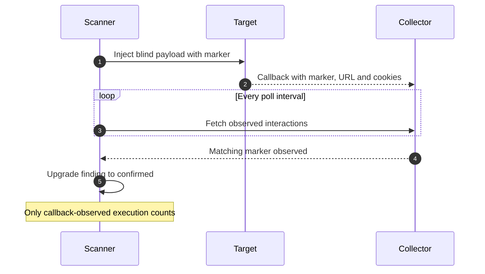
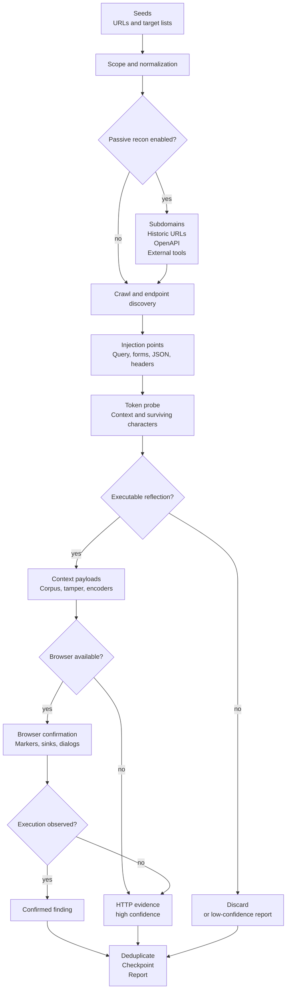
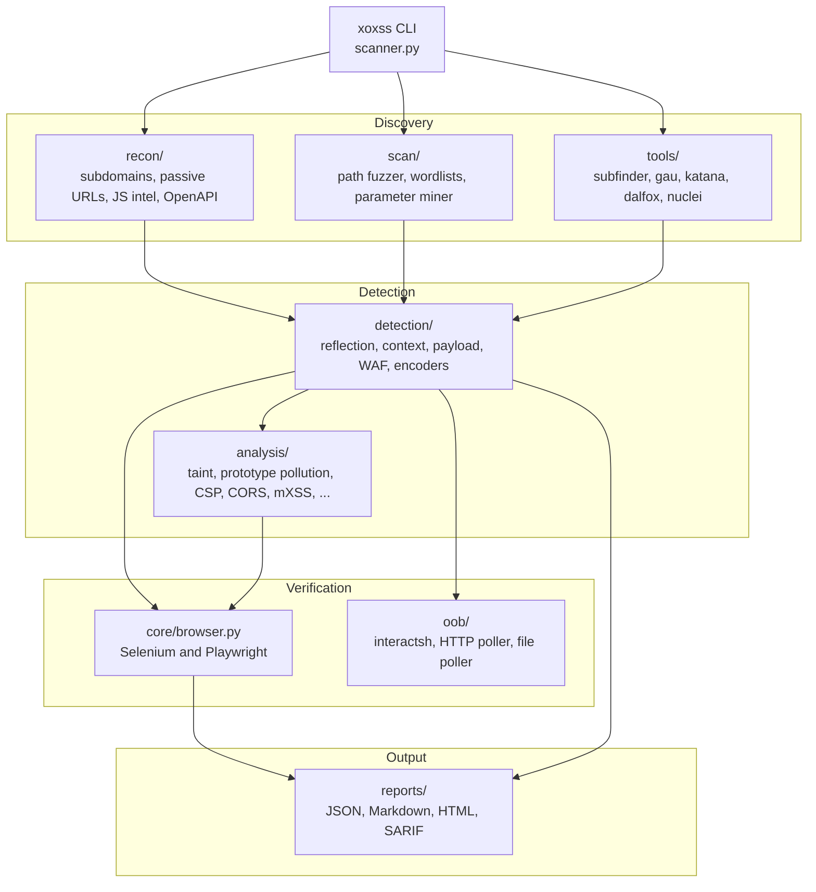

# XOX$$

**Advanced, persistent, context-aware XSS scanner for authorized security testing.**

[](#requirements)

[](LICENSE)
[](#sarif)
[](#security-and-legal)

> [!WARNING]
> XOX$$ sends attack payloads. Use it only against systems you own or have explicit
> written permission to test. You are responsible for the targets you scan and for the
> data your payloads, callbacks and reports collect.

XOX$$ (`xoxss`) is a Python XSS scanner built around one rule: **evidence before
findings**. It probes over HTTP first, classifies the reflection context, and only then
asks a real browser to prove execution. The same engine also covers passive
reconnaissance, JavaScript intelligence, OpenAPI operations, blind XSS through
out-of-band callbacks, prototype pollution, and large URL-list triage.

It is designed for three kinds of work:

- **Manual testing and bug bounty** — crawl a target, find injection points, and get
  browser-confirmed evidence with reproducible payloads.
- **CI and regression checks** — run HTTP-only scans, emit SARIF, and fail a build when
  an actionable finding appears.
- **Large-surface triage** — sweep tens of thousands of URLs in stateless mass mode and
  stream JSONL for downstream processing.

The CLI is the stable interface. `python xoxss.py`, `python -m xoxss` and the installed
`xoxss` command all run the same implementation in `xoxss/scanner.py`.

## Contents

- [Why XOX$$](#why-xox)
- [Feature overview](#feature-overview)
- [How it works](#how-it-works)
- [Requirements](#requirements)
- [Installation](#installation)
- [Quick start](#quick-start)
- [Command reference](#command-reference)
- [Usage recipes](#usage-recipes)
- [Reports and exit codes](#reports-and-exit-codes)
- [State and resume](#state-and-resume)
- [Configuration](#configuration)
- [Architecture](#architecture)
- [Using as a library](#using-as-a-library)
- [Performance and scaling](#performance-and-scaling)
- [Troubleshooting](#troubleshooting)
- [Development](#development)
- [Limitations and non-goals](#limitations-and-non-goals)
- [Contributing](#contributing)
- [Security and legal](#security-and-legal)
- [Acknowledgements](#acknowledgements)
- [License](#license)

## Why XOX$$

Most XSS scanners either fire thousands of payloads and hope, or require a browser for
every request. XOX$$ separates the two jobs:

1. **Cheap evidence first.** A token probe determines whether input is reflected and
   which characters survive. Escaped output is discarded before it costs a browser boot.
2. **Execution proof second.** Only real candidates reach Selenium or Playwright. A
   finding is `confirmed` only when a unique marker executes (including runtime DOM
   execution) or a dialog is observed. Data that reaches a sink without executing stays
   `medium` taint evidence.
3. **State that survives reality.** Checkpoints are atomic and written after every URL
   and every finding. Interrupted scans resume instead of starting over.
4. **A pipeline, not a single trick.** Crawling, passive recon, JS analysis, OpenAPI,
   parameter mining, OOB confirmation and reporting share one finding model.

The result is fewer false positives, reproducible evidence, and a scan that can be
stopped, resumed, scripted and reported without a second tool.

## Feature overview

### Detection

- **Context-aware payloads** for HTML, double-quoted attributes, single-quoted
  attributes, unquoted attributes, `<script>`, `<style>`, comments, JSON,
  `javascript:` URLs and generic fallback contexts.
- **HTTP-first probing with browser confirmation.** Selenium (Firefox, Chrome, Edge) or
  Playwright drives only the candidates that survive the HTTP stage.
- **Execution markers instead of blocking dialogs.** Payloads write a random token to
  `window.__xoxss_hits`; `alert`, `confirm` and `prompt` are intercepted and recorded.
- **Runtime DOM instrumentation** for `innerHTML`, `outerHTML`, `document.write`,
  `insertAdjacentHTML`, `eval`, `setTimeout` and `setInterval`. The scanner distinguishes
  *confirmed* DOM execution from *static sink taint*.
- **Reflected, stored, header and DOM XSS**, with an explicit confidence model instead of
  a binary “vulnerable” label.
- **Runtime prototype pollution** with marker proof, gadget fingerprinting and
  gadget-specific exploit URLs.
- **Mutation XSS (mXSS) hints** from sanitizer and version detection.
- **Optional adjacent analyzers:** JSONP endpoints, CSP bypass opportunities, CORS
  misconfigurations, DOM clobbering, Trusted Types, GraphQL, WebSocket, file upload and
  `postMessage` surfaces.

### Discovery

- Level-by-level concurrent crawler with depth and URL budgets.
- Links, forms, iframes, `object`, meta-refresh, `robots.txt`, recursive sitemaps, inline
  and external JavaScript.
- JavaScript intelligence: hidden endpoints, parameter names, GraphQL/WebSocket URLs,
  source maps, embedded `sourcesContent`, leaked credential patterns, and source-to-sink
  taint flows with sanitizer awareness.
- OpenAPI/Swagger discovery, including path parameters and JSON/form request bodies.
- Passive subdomain enumeration (crt.sh, certspotter, HackerTarget, OTX, urlscan) and
  historic URL mining (Wayback, Common Crawl, urlscan, OTX).
- **Parameter audit** combining collector-style Wayback harvesting with Gxss-style
  one-parameter-at-a-time reflection probing, ranked by parameter name risk and usage.
- Internal path fuzzing with soft-404 detection, hidden-parameter mining, and parameter
  fuzzing on endpoints that expose no query string.
- Optional orchestration of installed `subfinder`, `gau`, `waybackurls`, `katana`, `httpx`,
  `dalfox` and `nuclei` binaries.

### Payloads and evasion

- Ten context-specific built-in payload families, a rotating remote corpus and the bundled
  6,900+ entry LazyXss payload pack.
- Eight tamper transforms (`doubleencode`, `hexencode`, `htmlentities`, `jscomment`,
  `jsonfuzz`, `spacetab`, `uppercase`, `urlencode`) and the `all` chain.
- Twenty composable encoders, including entity variants, JS escapes, `fromCharCode`,
  base64/eval, comment breaks, `%uXXXX`, UTF-16LE, full-width characters and null bytes.
- Remote payload lists downloaded to temporary storage and cleaned up automatically, with
  graceful fallback when offline.
- Local corpora from individual files, path-separated file lists, JSON arrays, or whole
  directories.

### Out-of-band confirmation

- Blind XSS injections that phone home with a marker, page URL and cookies.
- Native interactsh client with RSA-OAEP/AES-CTR encryption and correlation IDs.
- Generic JSON/NDJSON poller for XSS Hunter, Burp bridges or custom collectors.
- Local file tailer for interactsh-client or self-hosted collectors.
- Background polling that upgrades a low-confidence injection to a confirmed finding when
  the callback arrives, plus a post-scan grace period for late callbacks.



### Operations and reporting

- `--god` / `--yolo` full-automatic preset: recon, deep crawl, fuzzing, browser
  verification, interactsh and external tools in one flag, no further input needed.
- Persistent checkpoints, resume, and cross-run finding deduplication.
- WAF fingerprinting (header/cookie/body signatures) and an active blocking probe.
- Retries with exponential backoff, `Retry-After` support, token-bucket rate limiting,
  optional adaptive (`--smart-rate`) limiting, proxy support and request concurrency.
- Multi-target runs, target lists, BOM tolerance, scope regexes and subdomain control.
- Stateless mass mode for very large URL lists, with JSONL output.
- Console, JSON, Markdown, self-contained HTML and SARIF v2.1.0 reports.
- Optional browser screenshots for confirmed findings.
- Preflight diagnostics with `--doctor`.

## How it works



### Detection stages

1. **Scope and discovery.** The target is normalized (`http://` is assumed for bare
   domains). Optional passive recon and external-tool seeds run before the same-origin
   crawl. Destructive paths (`logout`, `delete`, `unsubscribe`, …) and binary assets are
   skipped.
2. **Injection points.** Existing query parameters, GET/POST form fields, query-bearing
   links, OpenAPI parameters and fuzzed parameter names all become `InjectionPoint`
   objects with a method, parameter, page URL and optional JSON body.
3. **Probe.** A unique token plus special characters is sent. The response is aligned
   with the sent payload to determine the context and whether `<`, `>`, quotes, `=` and
   parentheses survived.
4. **Payload selection.** Context-specific templates are rendered with a second unique
   marker. A controlled share of slots is sampled from the remote corpus; local corpus
   entries fill the rest.
5. **HTTP evidence.** If a payload is reflected unescaped, the scanner records `high`
   confidence when browser verification is unavailable or inconclusive.
6. **Browser confirmation.** For GET points the scanner navigates; for forms it fills and
   submits. It then checks `window.__xoxss_hits`, intercepted dialogs and instrumented
   sinks. Execution upgrades the finding to `confirmed`.
7. **Persistence and reporting.** Findings are deduplicated by family, URL, parameter,
   method and optional subkey, then written to the checkpoint and every requested report
   format.

### Confidence model

| Confidence | Meaning | Counts toward `--fail-on-findings` |
|---|---|---|
| `confirmed` | The marker executed, reached a live sink, or produced an observed dialog in a browser. | Yes |
| `high` | Payload reflected unescaped / persisted, but execution was not re-confirmed. | Yes |
| `medium` | Header reflection, DOM sink taint, or a polluted prototype with a non-firing gadget candidate. | No |
| `low` | Reflected but not executable, a static DOM candidate, or an unconfirmed blind injection. Static candidates usually require `--report-reflections`. | No |

Blind injections start at `low`; they become `confirmed` only when a polling transport
observes the callback. `--report-reflections` also enables low-confidence static DOM
candidates and sanitized taint flows.

## Requirements

| Component | Required | Notes |
|---|---|---|
| Python | **3.9+** | CI covers 3.9, 3.12 and 3.13. |
| `aiohttp` | Yes | HTTP engine, concurrency, retries. |
| `beautifulsoup4` | Yes | HTML parsing and form extraction. |
| `selenium` + `webdriver-manager` | Yes for browser mode | Drivers are resolved by Selenium Manager first, then webdriver-manager. |
| Firefox / Chrome / Edge | Yes for Selenium mode | Use `--no-browser` for HTTP-only operation. |
| Playwright | Optional | `--browser playwright`; requires `playwright install chromium`. |
| `cryptography` | Optional | Native `--interactsh` decryption. |
| `uvloop` | Optional | Faster event loop on non-Windows platforms. |
| External binaries | Optional | `subfinder`, `gau`, `waybackurls`, `katana`, `httpx`, `dalfox`, `nuclei`; missing tools contribute nothing. |

Operating systems: Linux, macOS and Windows. On Windows, `uvloop` is skipped and Selenium
Manager resolves the browser driver. The scanner degrades to HTTP-only mode when no
browser is available.

## Installation

### From source (recommended)

```bash
# from a checkout of this project

# install the package and the `xoxss` console script
pip install .

# or an editable development install
pip install -e ".[dev]"

# runtime dependencies only, without packaging
pip install -r requirements.txt
```

`pip install .` uses the PEP 621 metadata in `pyproject.toml`. The console script
`xoxss` and `python -m xoxss` are equivalent.

### Optional extras

```bash
# native interactsh client
pip install ".[interactsh]"

# Playwright backend
pip install ".[playwright]"
playwright install chromium

# everything above plus test/type-check tooling
pip install -e ".[dev,interactsh,playwright]"
```

### Docker

The included image is intentionally HTTP-only: it contains no browser and no external
scanners. It runs as a non-root user and is suitable for reflection checks in CI.

```bash
docker build -t xoxss .
docker run --rm -v xoxss-data:/data xoxss \
  https://target.tld/?q=1 \
  --no-browser --no-state --no-remote-payloads \
  --state-dir /data --report-dir /data/reports
```

If you need browser confirmation, run the package on a host with a browser and a driver,
or use Playwright outside the image.

### Verify the installation

```bash
xoxss --doctor
xoxss --doctor --no-browser     # HTTP-only deployment
```

`--doctor` checks the Python version, required and optional modules, external tool
availability, state-directory writability and the selected browser backend. It exits
non-zero only when a required component is missing. Optional warnings (missing
`cryptography`, missing `uvloop`, absent external tools) do not fail the check.

### Windows notes

- `uvloop` is not installed on Windows; the standard asyncio loop is used.
- Use PowerShell quoting for cookies and headers:
  `--cookies "session=abc; theme=dark"`.
- Selenium Manager normally downloads the correct driver automatically. If it is blocked,
  install the matching driver and use `--binary` for the browser executable.

## Quick start

```bash
# 0. God mode: everything below, fully automatic, no extra flags
xoxss example.com --god          # alias: --yolo

# 1. Fast HTTP-only triage of a single parameter
xoxss "https://target.tld/?q=1" --no-browser --report json,sarif

# 2. Harvest a domain and find reflecting parameters (collector + Gxss)
xoxss example.com --param-audit --param-output params.json

# 3. Crawl, confirm in a headless browser, save evidence
xoxss https://target.tld --crawl --deep \
  --browser playwright --headless --screenshot \
  --report all

# 4. Triage a large URL list without a browser
xoxss -l urls.txt --mass --jsonl findings.jsonl --concurrency 32
```

A confirmed finding is printed with its URL, parameter, method, payload, context and
evidence. JSON, Markdown, HTML and SARIF files are written to `.xoxss/reports/` by
default, with a `-latest` copy for each format.

## Command reference

Run `xoxss --help` for the authoritative generated reference. The tables below group the
same options by workflow and include the default where one exists.

### Targets and scope

| Option | Description |
|---|---|
| `TARGET ...` | One or more URLs or bare domains. Bare domains get `http://`. |
| `-l, --target-list PATH` | File with one target per line. Blank lines and `#` comments are ignored. |
| `--allow-subdomains` | Treat subdomains as in scope. Automatically enabled for subdomain/external recon. |
| `--include REGEX ...` | URLs must match at least one regex. |
| `--exclude REGEX ...` | URLs matching any regex are skipped. |
| `--crawl` | Crawl before scanning. |
| `--deep` | Preset: crawl, depth ≥ 5, ≥ 1500 URLs, endpoint discovery, path probing and parameter fuzzing. |
| `--god`, `--yolo` | Full-automatic maximum-aggression preset — see [God mode](#god-mode). Not combinable with `--mass` or `--param-audit`. |
| `--crawl-depth N` | Maximum crawl depth (default: `3`). |
| `--max-urls N` | Maximum URLs to scan (default: `500`). |
| `--discover` / `--no-discover` | Parse robots.txt, sitemaps and JavaScript (default: on). |
| `--discover-paths` | Probe 41 common endpoint paths. |
| `--endpoint-wordlist PATH` | Extra paths for `--discover-paths`, one per line. |
| `--js-files N` | Maximum JavaScript files parsed per scan (default: `25`). |
| `--fuzz-params` / `--no-fuzz-params` | Append common parameter names to parameterless endpoints (default: off). |
| `--fuzz-param-limit N` | Parameter names tried per endpoint (default: `10`). |
| `--subdomains` | Passive subdomain enumeration before scanning. |
| `--subdomain-brute N` | Also resolve the first N built-in/wordlist candidates. |
| `--passive-urls` | Mine Wayback, Common Crawl, urlscan and OTX for historic URLs. |
| `--openapi` | Discover OpenAPI/Swagger documents and expand their operations. |
| `--fuzz-paths` | Run the internal soft-404-aware path fuzzer. |
| `--mine-params` | Probe high-signal parameter names and keep ones that affect the response. |
| `--external-tools` | Use installed external recon/verification binaries. |

### Payloads and injection

| Option | Description |
|---|---|
| `--payload-file PATH` | Custom payloads. Accepts a single file, an `os.pathsep`-separated list, or a JSON array. |
| `--payload-dir DIR` | Load every `.txt`, `.lst` and `.json` file under `DIR` recursively. Repeatable. |
| `--lazy-payloads` / `--no-lazy-payloads` | Load the bundled LazyXss pack (6,900+ payloads; default: on). |
| `--remote-payloads` / `--no-remote-payloads` | Download the temporary GitHub payload corpus (default: on). |
| `--payload-source URL` | Extra raw payload URL. Repeatable. |
| `--payload-limit N` | Maximum remote payloads kept (default: `600`; hard cap: `5000`). |
| `--payload-tmp-dir DIR` | Root for the temporary payload cache. |
| `--keep-payloads` | Keep the temporary payload directory after the scan. |
| `--tamper NAME` | Tamper transform: `doubleencode`, `hexencode`, `htmlentities`, `jscomment`, `jsonfuzz`, `spacetab`, `uppercase`, `urlencode`, `all`. |
| `--encoder NAME` | Encoder-registry transform. Repeatable; see `--list-encoders`. |
| `--max-payloads N` | Payloads per injection point (default: `6`). |
| `--scan-headers` | Test header reflection. |
| `--header-list HEADER ...` | Header names to inject. Defaults to a curated set. |
| `--dom` / `--no-dom` | DOM XSS analysis (default: on). |
| `--stored` | Look for persisted payloads after POST submissions. |
| `--stored-pages N` | Pages checked for stored XSS (default: `10`). |
| `--report-reflections` | Also report non-executable reflections and static DOM candidates. |
| `--check-libs` / `--no-check-libs` | JavaScript library vulnerability detection (default: on). |
| `--blind CALLBACK_URL` | Inject out-of-band blind-XSS probes into every injection point. |

### Optional analyzers

| Option | Description |
|---|---|
| `--jsonp` | Detect and test JSONP callback endpoints. |
| `--csp-analyze` | Analyze CSP headers for bypass opportunities. |
| `--cors-analyze` | Check for CORS misconfigurations. |
| `--mxss` | Mutation XSS heuristics from sanitizer/version detection. |
| `--proto-pollution` | Runtime prototype-pollution proof, gadget fingerprinting and gadget URLs. |
| `--dom-clobbering` | DOM clobbering analysis. |
| `--trusted-types` | Trusted Types CSP analysis. |
| `--graphql` | GraphQL endpoint XSS checks. |
| `--websocket` | WebSocket XSS checks. |
| `--file-upload` | File upload XSS analysis. |
| `--postmessage` | `postMessage` handler analysis. |
| `--polyglot` | Use polyglot payloads for faster coverage. |
| `--per-char-probe` | Per-character probing for precise context detection. |
| `--smart-rate` | Adaptive smart rate limiting instead of a fixed token bucket. |

### Out-of-band confirmation

| Option | Description |
|---|---|
| `--blind CALLBACK_URL` | Callback base or collector URL used by injected payloads. |
| `--interactsh [SERVER]` | Register with an interactsh server (default: `oast.pro`) and poll it. |
| `--oob-poll URL` | Poll a JSON/NDJSON collector endpoint for markers. |
| `--oob-file PATH` | Tail a local JSON-lines/text collector file. Requires `--blind` or `--interactsh`. |
| `--oob-interval SECONDS` | Poll cadence (default: `5`). |
| `--oob-wait SECONDS` | Grace period after the scan for late callbacks (default: `0`). |

### Browser verification

| Option | Description |
|---|---|
| `--browser {firefox,chrome,chromium,edge,playwright}` | Backend (default: `firefox`). |
| `--headless` | Run the browser headless. |
| `--no-browser` | HTTP-only mode; sets `--confirm http`. |
| `--browser-workers N` | Parallel browser instances (default: `1`). Each engine serialises its own work. |
| `--confirm {auto,browser,http}` | Verification strategy (default: `auto`). `auto` uses the browser when available. |
| `--screenshot` | Save screenshots for confirmed findings. |
| `--binary PATH` | Explicit browser executable. |
| `--user-agent STRING` | User-Agent override for HTTP requests and browser sessions. |

### Network and authentication

| Option | Description |
|---|---|
| `--threads N` | Parallel URL workers (default: `10`). |
| `--concurrency N` | Parallel HTTP requests (default: `16`). |
| `--timeout SECONDS` | Request/browser timeout (default: `20`). |
| `--retries N` | Retries per request (default: `2`). |
| `--rate-limit N` | Global requests-per-second cap; `0` is unlimited (default: `0`). |
| `--proxy URL` | HTTP(S) proxy, for example `http://127.0.0.1:8080`. |
| `--insecure` | Disable TLS certificate verification. Authorized targets only. |
| `--headers "Name: Value" ...` | Extra HTTP headers, including `Authorization`. |
| `--cookies "name=value; name2=value2" ...` | Cookies for HTTP probes. |

> [!NOTE]
> `--headers` and `--cookies` apply to the HTTP engine. A browser verification session
> is not seeded with those cookies or headers. Authenticated areas that require browser
> confirmation should be reached through a proxy or an unauthenticated equivalent flow.

### Mass mode

| Option | Description |
|---|---|
| `--mass` | Stateless HTTP sweep: no crawl, browser, checkpoint, OOB or automatic reports. |
| `--mass-params NAMES` | Comma-separated fallback parameters for URLs without a query string. |
| `--mass-payloads N` | Payloads per parameter (default: `4`). Extra slots can come from local corpora. |
| `--jsonl PATH` | Append one JSON finding object per line. |

### Parameter audit (collector + Gxss)

`--param-audit` is a standalone reconnaissance mode. It harvests historic URLs the same
way `collector` does, extracts unique parameter names, then tests each parameter
individually by substituting a unique marker (the core idea from `Gxss`). It does not crawl,
launch a browser, download payloads, or create a checkpoint.

| Option | Description |
|---|---|
| `--param-audit` | Run the standalone parameter harvest and reflection audit, then exit. |
| `--param-input PATH` | Read seed URLs from a file. When used alone, Wayback harvesting is skipped. |
| `--param-source {wayback,passive,both,none}` | URL source (default: `wayback`, or `none` with `--param-input`). |
| `--param-subs` / `--no-param-subs` | Include subdomains in Wayback harvesting (default: on). |
| `--param-limit N` | Maximum historic URLs to harvest (default: `5000`). |
| `--param-max-checks N` | Maximum parameter names to probe (default: `10000`). |
| `--param-marker STRING` | Alphanumeric marker prefix (default: `XoxssReflect`). |
| `--param-data BODY` | POST form body for Gxss-style `-d` checks, e.g. `user=test&pass=test`. |
| `--param-output PATH` | Write the JSON audit report. |
| `--jsonl PATH` | Append one candidate/reflection object per line. |

A reflected parameter is **evidence of reflection, not execution**. The JSON deliberately
keeps `executable: false`; use the main scanner or `--mass` to test exploitability.

> [!NOTE]
> collector's README advertises vulnerable-parameter detection, but its published script
> only harvests Wayback URLs and checks host status. XOXSS keeps the useful CDX harvest and
> adds parameter extraction, ranking and the Gxss-style reflection probe on top.

The audit JSON contains `mode`, `targets`, `source`, `stats`, `errors` and a `candidates`
array. Each candidate records `name`, `count`, `risk`, the collected `urls`, `sources`,
`sample_url`, `reflected`, `context`, `status`, `method`, `probe_url`, `marker`, `evidence`
and `executable`. JSONL is one candidate object per line.

### Output and persistence

| Option | Description |
|---|---|
| `-o, --output PATH` | Write the full console log to a file. |
| `--report LIST` | `json`, `md`, `html`, `sarif`, a comma-separated combination, `all` or `none` (default: `all`). |
| `--report-dir DIR` | Report directory (default: `.xoxss/reports`). |
| `--state-dir DIR` | Checkpoint, screenshot and default report root (default: `.xoxss`). |
| `--no-state` | Disable checkpoints. |
| `--no-resume` | Ignore and reset an existing checkpoint. |
| `--verbose` | Debug output. |
| `--quiet` | Only findings and errors. |
| `--no-color` | Disable ANSI colours. `NO_COLOR` is also honoured. |
| `--fail-on-findings` | Exit `2` when confirmed/high findings exist. |

### Diagnostics

| Option | Description |
|---|---|
| `--doctor` | Check the installation and exit. |
| `--list-payloads` | Print built-in payload families and exit. |
| `--list-tampers` | Print tamper transforms and the `all` chain. |
| `--list-encoders` | Print the encoder registry. |
| `--version` | Print the version and exit. |

## Usage recipes

### God mode (`--god` / `--yolo`)

```bash
xoxss example.com --god
```

God mode is the everything-on, hands-off preset: pass one flag, pick your target
(URL, bare domain, or `-l targets.txt`) and walk away. It automatically enables a
best-of-everything configuration and retries degraded setups instead of asking questions:

- **Recon and scope**: passive subdomain enumeration, subdomain brute-force of the first
  50 candidates, `--allow-subdomains`, passive URL mining (Wayback / Common Crawl /
  urlscan / OTX), OpenAPI discovery, hidden parameter mining.
- **Discovery**: crawl at depth ≥ 6 with ≥ 3000 URLs, 60 parsed JavaScript files, path
  discovery, path fuzzing and parameter fuzzing (25 names per endpoint).
- **Injection**: ≥ 16 payloads per injection point, ≥ 1500 remote payloads (plus the
  bundled LazyXss pack), header injection, stored-XSS hunting (20 pages) and
  reflection reporting.
- **Analyzers**: polyglots, JSONP, prototype pollution, mXSS, CSP and CORS analysis and
  adaptive smart rate limiting.
- **Verification**: the fastest browser available (Playwright if importable, otherwise
  Chrome/Edge/Firefox found on PATH, with an explicit binary path where needed), two
  headless workers and automatic screenshots for confirmed findings. With no browser at
  all it continues HTTP-only.
- **Blind XSS**: registers with a public interactsh server (`oast.pro`) and polls for
  out-of-band callbacks, unless you already supplied `--blind`, `--interactsh`,
  `--oob-poll` or `--oob-file`.
- **External tools**: dalfox/nuclei/subfinder/gau/katana are used automatically when
  installed.

Networking is raised to 20 workers x 32 concurrent requests with a 30 s timeout.
Explicit command-line flags always win, so `xoxss example.com --god --max-urls 500`
still applies god mode everywhere except the URL budget. `--god` cannot be combined
with the standalone `--mass` or `--param-audit` modes.

> Authorized targets only — god mode is deliberately loud and thorough.

### Fast HTTP-only triage

```bash
xoxss "https://target.tld/search?q=test" \
  --no-browser \
  --max-payloads 10 \
  --report json,sarif
```

HTTP-only mode skips browser launches entirely. Findings are reported as `high` when
the payload is reflected unescaped. This is the right mode for a first pass, CI, or a
machine without a browser.

### Crawl and confirm in the browser

```bash
xoxss https://target.tld \
  --crawl --deep \
  --browser playwright --headless \
  --screenshot \
  --report all
```

`--deep` raises the crawl to depth 5 and at least 1500 URLs, enables endpoint discovery,
and turns on parameter fuzzing. Playwright avoids Selenium driver binaries:

```bash
pip install ".[playwright]"
playwright install chromium
```

### Authenticated scan

```bash
xoxss -l targets.txt \
  --headers "Authorization: Bearer $TOKEN" \
  --cookies "session=$SESSION" \
  --rate-limit 10 \
  --threads 8 \
  --no-browser \
  --report json,html
```

Credentials are visible to the local process list and may be captured by shell history.
Prefer a wrapper that reads secrets from a vault or environment, and avoid pasting
production tokens into shared terminals. Browser verification does not inherit these
credentials; see the note in the command reference.

### Full discovery

```bash
xoxss https://target.tld \
  --subdomains --subdomain-brute 200 \
  --passive-urls \
  --openapi \
  --fuzz-paths \
  --mine-params \
  --fuzz-params \
  --crawl --crawl-depth 4 --max-urls 1200 \
  --no-browser
```

Reconnaissance is opt-in. Subdomain enumeration widens scope to the registrable domain;
historic-URL collection then keeps only in-scope hosts. `--include` and `--exclude` can
constrain either result.

### Blind XSS with interactsh

```bash
xoxss https://target.tld \
  --crawl \
  --interactsh \
  --oob-wait 60 \
  --no-browser
```

The native client registers, builds a callback label per marker, polls in the background
and decrypts interactions. A callback upgrades the injected finding to
`Blind XSS (callback confirmed)`. Use a self-hosted server with `--interactsh https://...`
when callbacks must stay inside your infrastructure.

### Blind XSS with a custom collector

```bash
# collector that exposes observed requests as JSON or NDJSON
xoxss https://target.tld --crawl \
  --blind https://collector.example/collect \
  --oob-poll https://collector.example/hits \
  --oob-wait 30
```

```bash
# local file written by interactsh-client or a self-hosted collector
xoxss https://target.tld --crawl \
  --blind https://collector.example/collect \
  --oob-file ./interactions.jsonl \
  --oob-wait 30
```

`--oob-file` only reads observed callbacks; it needs `--blind` for the injection URL or
`--interactsh` for a generated one. The poller accepts `data`, `hits`, `requests`,
`results`, `interactions` or `events` arrays, a single object, or one interaction per
line.

### Mass URL triage

```bash
xoxss -l urls.txt \
  --mass \
  --mass-params "q,search,term,filter,page" \
  --mass-payloads 6 \
  --jsonl findings.jsonl \
  --concurrency 40 \
  --rate-limit 100
```

Mass mode rewrites existing parameters one at a time. URLs without a query string get
the fallback list. It does not crawl, launch a browser, write a checkpoint, fetch remote
payloads, or write the normal report formats. Only executable reflections are emitted,
as `Reflected XSS (HTTP evidence)` with `confidence: high`. `--tamper` and `--encoder`
transforms are applied to each request. `--jsonl` is the machine output;
`--fail-on-findings` returns exit code 2 when anything actionable is found.

### Parameter audit with collector and Gxss logic

```bash
xoxss example.com \
  --param-audit \
  --param-output artifacts/params.json \
  --jsonl artifacts/params.jsonl
```

The audit pulls `*.example.com/*` from the Wayback CDX API (collector behavior), extracts
parameter names and how often each appears, then rewrites one parameter at a time with a
unique marker and checks the response without following redirects (Gxss behavior). Reflected
candidates are printed first, including their context and a reproducing URL. To audit a
specific set of URLs offline:

```bash
xoxss example.com \
  --param-audit \
  --param-input urls.txt \
  --param-source none \
  --param-output artifacts/params.json
```

For POST forms, pass a body; the audit tests each field in the body independently:

```bash
xoxss https://target.tld/login \
  --param-audit \
  --param-source none \
  --param-data "user=test&pass=test" \
  --param-output artifacts/login-params.json
```

Use `--param-source passive` to add Common Crawl, urlscan and OTX URLs to the Wayback
harvest. `--fail-on-findings` exits 2 when at least one parameter reflects. Reflected
candidates include a `probe_url`; feed those URLs to `--mass` or the main scanner to test
exploitability.

### Runtime prototype pollution

```bash
xoxss https://target.tld \
  --proto-pollution \
  --browser playwright --headless \
  --report json,html
```

The scanner combines static hints from JavaScript with runtime proof:

1. Probe URLs inject `__proto__[xoxss]` and `constructor[prototype][xoxss]` in query and
   fragment spellings, plus dot variants, each carrying a unique marker.
2. The browser evaluates a fresh object. A finding is emitted only when the marker is
   inherited from `Object.prototype` after the page's own parser or merge code runs.
3. The page is fingerprinted for jQuery, Vue, Lodash, DOMPurify, Angular, GTM and similar
   gadgets. Gadget-specific exploit URLs are navigated next and an alert carrying a second
   marker proves execution.
4. If pollution is proven and a fingerprinted gadget does not fire, a medium-confidence
   candidate records the reproducible URL for manual follow-up.

Each probe is a real navigation, so expect six probe page loads per scanned URL plus
gadget attempts when a gadget is present. With `--no-browser`, only static source hints
are logged.

### WAF evasion chain

```bash
xoxss https://target.tld \
  --tamper uppercase \
  --encoder urlencode \
  --encoder js_unicode \
  --max-payloads 12 \
  --rate-limit 5 \
  --no-browser
```

Tamper transforms run first, then the encoder chain. Use `--list-tampers` and
`--list-encoders` to inspect the registries. Evasion is not guaranteed; reduce the rate
and review blocked requests before increasing the payload count.

### Local payload corpus

```text
payloads/
  xss.txt          # one payload per line, optional "context|payload" prefix
  custom.json      # ["<svg onload=...>", {"payload": "...", "context": "script"}]
  vendor/
    legacy.lst
```

```bash
xoxss https://target.tld \
  --payload-dir ./payloads \
  --max-payloads 15 \
  --no-remote-payloads \
  --no-browser
```

Valid context identifiers are `html`, `attr_double`, `attr_single`, `attr_unquoted`,
`script`, `style`, `comment`, `json`, `url` and `generic`. Untagged lines are classified
automatically and also registered for generic contexts. Duplicates are skipped across
every file. A single file can be supplied with `--payload-file`; use the platform path
separator to pass several.

XOXSS also ships the LazyXss payload list as `xoxss/data/lazyxss.txt`. It is enabled by
default and sampled alongside the curated corpus; disable it with `--no-lazy-payloads`.
See `xoxss/data/LAZYXSS_NOTICE.md` for provenance and the upstream licensing caveat.

### CI with SARIF

```bash
xoxss "$TARGET" \
  --no-browser \
  --no-remote-payloads \
  --no-state \
  --report sarif \
  --report-dir artifacts \
  --fail-on-findings
```

```yaml
- name: XSS scan
  run: |
    xoxss "$TARGET" --no-browser --no-remote-payloads --no-state \
      --report sarif --report-dir artifacts --fail-on-findings

- name: Upload SARIF
  if: always()
  uses: github/codeql-action/upload-sarif@v3
  with:
    sarif_file: artifacts
```

Only `confirmed` and `high` findings make `--fail-on-findings` return 2. Low-confidence
blind injections do not fail a build until they are confirmed.

### Docker and offline runs

```bash
docker run --rm \
  -v xoxss-data:/data \
  -v "$PWD/payloads:/data/payloads:ro" \
  xoxss \
  https://target.tld/?q=1 \
  --no-browser --no-state \
  --no-remote-payloads \
  --payload-dir /data/payloads \
  --state-dir /data \
  --report-dir /data/reports
```

Use `--no-remote-payloads` for air-gapped environments and mount a local corpus when
built-ins are not enough. The image has no browser, so keep `--no-browser`.

## Reports and exit codes

### Console

The console prints a banner, scan progress, each finding with its evidence, and a final
summary containing request counts, URLs, endpoints, recon counters and report paths.
`--quiet` restricts output to findings and errors; `-o` mirrors the log to a file.

### Report files

Each requested format is written as:

```text
<report-dir>/xoxss-<host>-<sha1(target)[:6]>-<YYYYmmdd-HHMMSS>.<ext>
<report-dir>/xoxss-<host>-<sha1(target)[:6]>-latest.<ext>
```

Supported formats:

| Format | Ext | Contents |
|---|---|---|
| JSON | `.json` | Full payload: stats, recon, OOB, findings, proto hints, external findings. |
| Markdown | `.md` | Human-readable summary, tables, and per-finding details/payloads. |
| HTML | `.html` | Self-contained dark-theme report with summary cards and finding cards. |
| SARIF | `.sarif` | SARIF v2.1.0 for code scanning and defect platforms. |

Screenshots, when enabled, are saved to `<state-dir>/screenshots/` (`<token>.png` for
injection-point findings, `dom-<token>.png` for DOM findings) and linked from the
finding.

### JSON structure

The JSON report is intentionally explicit so downstream tooling does not have to parse
console text:

Abridged example (the real document also includes per-bundle JS intelligence, OpenAPI
operations and every finding field):

```json
{
  "tool": "XOX$$",
  "version": "2.0.0",
  "target": "https://target.tld/",
  "finished": "2026-11-03T10:00:00+00:00",
  "duration_seconds": 12.34,
  "waf": ["cloudflare"],
  "waf_blocking": false,
  "stats": {
    "requests": 480,
    "errors": 2,
    "blocked": 0,
    "payloads": 120,
    "points": 40,
    "urls_total": 12,
    "urls_done": 12,
    "findings": 1,
    "browser_checks": 8,
    "endpoints": 37,
    "js_files": 6,
    "secrets": 0,
    "subdomains": 14,
    "passive_urls": 220,
    "fuzzed_paths": 41,
    "discovered_params": 9,
    "ast_flows": 3,
    "oob_registered": 0,
    "oob_hits": 0,
    "external_findings": 0
  },
  "endpoint_count": 37,
  "endpoints": ["https://target.tld/search?q="],
  "recon": {
    "subdomains": [],
    "passive_urls": [],
    "openapi_operations": [],
    "external_tools": "",
    "js_intel": []
  },
  "oob": {},
  "external_findings": [],
  "vulnerable_libraries": [],
  "jsonp_findings": [],
  "csp_issues": [],
  "cors_issues": [],
  "proto_pollution_sources": [],
  "blind_markers": [],
  "findings": [
    {
      "kind": "Reflected XSS (HTTP evidence)",
      "url": "https://target.tld/search?q=...",
      "parameter": "q",
      "method": "GET",
      "payload": "<script>...</script>",
      "evidence": "marker reflected unescaped",
      "confidence": "high",
      "context": "html",
      "detail": "browser confirmation not attempted",
      "screenshot": "",
      "subkey": "q",
      "tags": ["mass"],
      "timestamp": "2026-11-03T10:00:00+00:00"
    }
  ]
}
```

`recon.js_intel` contains per-bundle endpoints, parameters, GraphQL/WebSocket URLs,
source maps, secrets and DOM flows. `oob`, when configured, contains the transport,
poll interval, marker registrations and observed hits. `proto_pollution_sources` contains
static hints (URL, frameworks, source types, gadget-chain presence); confirmed pollution
appears in `findings`.

### JSONL

`--jsonl PATH` is mass-mode output only: one JSON finding object per line, appended
across runs. It is designed for streaming into a queue, spreadsheet importer, or a
second-stage confirmation job. Full scans already have a complete JSON report.

### SARIF

SARIF rules are derived from the finding family, for example `xoxss/reflected-xss` or
`xoxss/stored-xss`. Confidence maps to severity:

| Confidence | SARIF level |
|---|---|
| `confirmed`, `high` | `error` |
| `medium` | `warning` |
| `low` | `note` |

### Exit codes

| Code | Meaning |
|---|---|
| `0` | Scan completed; no actionable findings, or `--fail-on-findings` was not set. |
| `1` | Fatal error, missing required dependency, invalid configuration, or `--doctor` found a required component missing. |
| `2` | Actionable findings with `--fail-on-findings`, or invalid CLI usage (argparse’s conventional exit code). |
| `130` | Interrupted with Ctrl+C; checkpoints are saved. |

## State and resume

```text
.xoxss/
  state/<host>-<sha1(target)[:12]>.json    # checkpoint: scanned URLs, findings, WAF, extras
  screenshots/<token>.png                  # optional confirmed-finding evidence
  reports/xoxss-<host>-<tag>-<stamp>.<ext> # timestamped reports
  reports/xoxss-<host>-<tag>-latest.<ext>  # latest copies
```

The checkpoint is written atomically with `os.replace` after each URL and each finding.
Re-running the same target resumes at the first unscanned URL and de-duplicates findings
across runs. `--no-state` disables writes; `--no-resume` resets and starts over.

> [!TIP]
> If you significantly change payloads, scope, authentication or crawl settings, use
> `--no-resume` for a clean run. Otherwise already-scanned URLs may be skipped.

Temporary remote payloads live in a unique directory under the system temp directory (or
`XOXSS_TMPDIR`/`--payload-tmp-dir`) and are removed in a `finally` block. `--keep-payloads`
retains them for inspection.

## Configuration

XOX$$ is configured through CLI flags. There is no implicit project config file to
override, which keeps CI runs reproducible.

Environment variables:

| Variable | Effect |
|---|---|
| `NO_COLOR` | Disable ANSI colour output (also available as `--no-color`). |
| `XOXSS_TMPDIR` | Root directory for the temporary remote payload cache. |

Network configuration:

- `--headers` and `--cookies` apply to HTTP probes, forms and recon requests.
- `--proxy` applies to HTTP requests and the browser backends that support it.
- `--insecure` disables TLS verification for the scan; use only on authorized targets.
- `--rate-limit` is a global token bucket. `--smart-rate` replaces it with an adaptive
  limiter that starts from `--rate-limit` (or 10 rps) and adjusts to responses.

Secret hygiene:

- Prefer a secret manager or an environment variable expanded by your shell.
- Be aware that command-line arguments can appear in process listings and shell history.
- Reports may contain URLs, payloads, cookies echoed by callbacks, and leaked secrets
  discovered in JavaScript. Treat report directories as sensitive.
- Blind payloads can exfiltrate cookies to your collector. Only use collectors you
  control and only on targets you are authorized to test.

## Architecture



### Project layout

```text
xoxss.py                  compatibility entry point for `python xoxss.py`
xoxss/
  scanner.py              CLI, HTTP engine, scan coordinator, reporting
  core/
    browser.py            Selenium and Playwright backends
    config.py             typed configuration schema (CLI remains authoritative)
  detection/
    reflection.py         token alignment, context and surviving-character analysis
    context.py            context classification helpers
    payload.py            blind payload construction
    dom.py                DOM source/sink analysis
    waf.py                WAF signatures and blocking heuristics
    encoders.py           composable encoder registry
  analysis/
    ast_taint.py          JavaScript source-to-sink flow analysis
    proto_pollution.py    static hints, probes, gadgets and exploit URLs
    jsonp.py csp.py cors.py mxss.py
    dom_clobbering.py trusted_types.py graphql.py
    websocket.py file_upload.py postmessage.py
    per_char.py polyglot.py rate_limit.py
  recon/
    subdomains.py         certificate/passive DNS sources
    passive.py            Wayback, Common Crawl, urlscan, OTX
    jsintel.py            bundle endpoints, secrets, source maps, taint
    openapi.py            Swagger/OpenAPI expansion
  oob/
    base.py               OOB manager, marker correlation, generic parsing
    interactsh.py         native RSA/AES interactsh client
    poller.py             HTTP and file pollers
  scan/
    fuzzer.py             path fuzzing, wordlists, parameter mining
    parameters.py         collector-style URL harvest + Gxss-style reflection probe
  tools/
    external.py           optional subfinder/gau/katana/dalfox/nuclei adapters
  reports/
    sarif.py              SARIF v2.1.0 export
  data/
    lazyxss.txt           bundled LazyXss payload pack
    LAZYXSS_NOTICE.md     payload provenance and licensing notice
  utils/                  console, helpers, markers, URL utilities
tests/                    pytest suite and manual integration scripts
```

Design notes:

- Optional imports are guarded. A missing `cryptography`, Playwright, Selenium or recon
  dependency degrades the relevant feature instead of preventing startup.
- Findings are deduplicated by family, URL, parameter, method and optional subkey. This
  collapses payload variants on the same injection point while still allowing multiple
  findings at one URL.
- Execution markers are quote-free where possible so the same marker survives HTML,
  attribute and JavaScript contexts without breaking the payload.
- The browser suppresses dialogs by design so a scan cannot stall on `alert()`. This
  slightly changes page behaviour and is intentional.

## Using as a library

The CLI is the supported interface, but the scanner can be embedded for custom
pipelines. The example below uses the same parser and scanner as the command line:

```python
import asyncio

from xoxss.scanner import Console, XSSScanner, build_parser

TARGET = "https://target.tld/?q=1"

args = build_parser().parse_args(
    [
        TARGET,
        "--no-browser",
        "--no-state",
        "--no-remote-payloads",
        "--report",
        "none",
        "--quiet",
    ]
)

scanner = XSSScanner(TARGET, args, Console(quiet=True))
findings = asyncio.run(scanner.run())

for finding in findings:
    print(finding.confidence, finding.kind, finding.parameter, finding.url)
```

`scanner.run()` starts and closes the HTTP engine and browser pool, writes reports unless
`--report none` is set, and returns the list of `Finding` objects. The internal API is not
versioned as a stable library contract; pin the version you embed.

## Performance and scaling

XOX$$ is HTTP-first: the expensive browser step runs only for candidates that survive the
probe. The main knobs are:

| Knob | Default | Effect |
|---|---|---|
| `--threads` | `10` | Concurrent URL workers. |
| `--concurrency` | `16` | Concurrent HTTP requests inside the engine. |
| `--browser-workers` | `1` | Parallel browser engines. Each engine serialises its own page work. |
| `--rate-limit` | `0` | Global requests per second; `0` is unlimited. |
| `--max-payloads` | `6` | Payloads per injection point. |
| `--payload-limit` | `600` | Remote corpus size. |
| `--js-files` | `25` | JavaScript files parsed per scan. |
| `--max-urls` | `500` | Crawl/scan URL budget. |

Practical guidance:

- **Triage first, confirm second.** Use `--no-browser` or `--mass` to find candidates,
  then re-scan promising URLs with browser confirmation.
- **Keep rate limits realistic.** A WAF that starts returning `403`/`429` makes the scan
  slower and noisier. Lower `--rate-limit`, reduce `--threads`, and inspect `blocked`
  counts before increasing payload volume.
- **Cap expensive discovery.** `--js-files`, `--max-urls` and `--payload-limit` bound the
  work; `--deep` deliberately raises the first two.
- **Skip remote downloads in CI.** `--no-remote-payloads` removes startup network
  dependency and makes runs reproducible.
- **Use mass mode for volume.** It avoids crawl, browser, checkpoint and report overhead,
  and streams JSONL for a second stage.

A synthetic local benchmark (40 URLs, one query parameter, one payload per parameter,
16-way concurrency) measured the full scanner at **1.83s** and mass mode at **1.34s**
(about **1.37×**). This is not a general performance promise: the gap depends on how much
discovery and confirmation the full scan performs, and mass mode’s default payload count
is higher than the benchmark’s single payload.

## Troubleshooting

Start with:

```bash
xoxss --doctor
```

| Symptom | Likely cause | Fix |
|---|---|---|
| `No browser available` | Selenium/browser/driver missing. | Install Selenium and a browser, use `--browser playwright` after `playwright install chromium`, or run `--no-browser`. |
| Playwright launch failure | Browser binaries not installed. | `playwright install chromium` (or install the package extra first). |
| `--interactsh` warns and does not confirm | `cryptography` missing, server unreachable, or registration rejected. | `pip install ".[interactsh]"`, check egress/TLS, or fall back to `--blind` plus `--oob-poll`/`--oob-file`. |
| No findings on an obviously reflective page | Escaped output, WAF filtering, missing parameter discovery, or candidate rejected before browser. | Try `--report-reflections`, increase `--max-payloads`, enable `--fuzz-params`/`--mine-params`, and inspect `blocked`/debug output. |
| Many `403`/`429` responses | Rate limiting or WAF. | Lower `--rate-limit` and `--threads`, add `--retries`, try `--tamper`/`--encoder`, or route through an authorized proxy. |
| TLS errors | Self-signed or internal certificate. | Use `--insecure` only on authorized targets. |
| `uvloop` warning on Windows | Optional dependency unavailable. | Ignore; the standard asyncio loop is used. |
| Empty JSONL in mass mode | Reflected value was escaped or written via `textContent`, so it was not executable. | Confirm the page reflects raw HTML; use the full scanner for DOM-only cases. |
| Prototype pollution finds no findings | No browser, page does not parse the probe, or pollution is server-side only. | Run with a browser backend; remember runtime probes require the page's own merge/parser to accept `__proto__`. |
| Reports missing | `--report none`, unwritable `--report-dir`, or a fatal startup error. | Check the summary, permissions, and `--report json`. |
| Docker cannot launch a browser | The image is HTTP-only by design. | Use `--no-browser` or run browser verification outside the container. |

Debugging tips:

- Add `--verbose` to see context classification, payload decisions and browser errors.
- Add `-o scan.log` to keep a timestamped log without losing console output.
- Use `--no-state` while iterating so stale checkpoints do not skip changed URLs.
- Use `--report-reflections` to see near-misses and understand why candidates were
  rejected.

## Development

### Setup

```bash
python -m venv .venv
source .venv/bin/activate           # Linux/macOS
# .venv\Scripts\activate            # Windows PowerShell

pip install -e ".[dev,interactsh]"
```

For Playwright-backed tests and manual checks:

```bash
pip install -e ".[playwright]"
playwright install chromium
```

### Tests

```bash
python -m pytest tests -q
python -m pytest tests -v
python tests/integration_smoke.py
```

The suite covers reflection scoring, context classification, blind payloads, WAF
matching, SARIF generation, encoders, AST taint, recon parsers, JS intelligence, OpenAPI
expansion, OOB correlation, external-tool parsing, mass mode, runtime prototype pollution
and a mock interactsh server. Browser-dependent tests skip when no browser is available.

Manual browser checks:

```bash
python tests/playwright_check.py
python tests/playwright_confirm_smoke.py
```

### Static checks and packaging

```bash
python -m compileall -q xoxss xoxss.py
python -m pip wheel --no-deps -w dist .
```

`pyrightconfig.json` configures Pyright/Pylance; its include scope is intentionally narrow
(`xoxss.py`). Do not weaken tests or type checks to make a change pass.

### CI

The GitHub Actions workflow runs the import/CLI surface checks, the full pytest suite and
the integration smoke test on Python 3.9, 3.12 and 3.13. It installs the package with
development extras and does not require a browser.

## Limitations and non-goals

- **Automated evidence is not a guarantee.** HTTP-only findings can be false positives
  when an application decodes or transforms input in a way the reflection heuristic does
  not model. Validate before reporting.
- **Header reflections cannot be browser-verified without an intercepting proxy.** They
  are reported as `medium` by design.
- **Stored XSS is persistence evidence.** The scanner re-fetches candidate pages over HTTP
  and reports a high-confidence `Stored XSS (payload persisted)` finding; it does not
  re-execute the stored payload in a second browser session.
- **Browser verification does not inherit CLI cookies or headers.** Authenticated browser
  flows need a proxy, a seeded session mechanism, or a reachable unauthenticated path.
- **Prototype-pollution gadgets are finite.** The scanner fingerprints known gadgets and
  emits a reproducible candidate when pollution is proven and a fingerprinted gadget does
  not fire; it does not synthesize arbitrary gadget chains.
- **Advanced analyzers are heuristics.** mXSS, CSP, CORS, DOM clobbering, Trusted Types,
  JSONP, GraphQL, WebSocket, file-upload and `postMessage` checks are supporting signals,
  not exhaustive protocol implementations.
- **Mass mode is triage, not confirmation.** It performs no crawling, browser work,
  checkpointing or OOB confirmation.
- **No distributed scanning.** Concurrency is local to one process. Run multiple processes
  with separate state/report directories if you need horizontal scale.
- **No built-in interception proxy.** Use `--proxy` with an external tool when you need to
  inspect or modify traffic.
- **No guarantee of WAF evasion.** Tamper and encoder chains improve coverage; they do not
  promise bypass.
- **XSS-focused.** The scanner includes adjacent checks (CORS, CSP, open redirects via
  reflection, secrets in JS), but it is not a full DAST platform.

## Contributing

1. Keep changes focused and explain the security rationale in the change description.
2. Add or update tests for behavioral changes. Do not weaken assertions, skip failing
   tests, or add suppressions to make a check pass.
3. Run `python -m pytest tests -q`, `python tests/integration_smoke.py` and
   `python -m compileall -q xoxss xoxss.py` before submitting.
4. Update this README when you add, rename or change a flag, report field or workflow.
5. Preserve authorized-testing safeguards: no stealth-only features, no destructive
   defaults, and no unconfirmed finding promoted to `confirmed` without evidence.

## Security and legal

- Use XOX$$ only against systems you own or have explicit written permission to test.
- Respect scope files, rate limits and program rules. A scanner that ignores scope is a
  liability, not a tool.
- Blind payloads may send cookies and page URLs to a collector. Use only collectors you
  control, and treat captured data as sensitive.
- Reports can contain credentials discovered in JavaScript. Restrict access to
  `.xoxss/` and any exported report directories.
- `--insecure` disables TLS verification. Do not use it on untrusted networks.
- Remote payload downloads contact GitHub at startup. Use `--no-remote-payloads` in
  restricted or air-gapped environments.
- The authors are not responsible for misuse or damage caused by this software.

## Acknowledgements

- [SecLists](https://github.com/danielmiessler/SecLists) and
  [PayloadsAllTheThings](https://github.com/swisskyrepo/PayloadsAllTheThings) for the
  public payload corpora the scanner can download.
- [LazyXss](https://github.com/iamunixtz/LazyXss) for the bundled payload list,
  [Gxss](https://github.com/KathanP19/Gxss) for the per-parameter reflection technique and
  [collector](https://github.com/thenurhabib/collector) for the Wayback parameter-harvest
  workflow. See `xoxss/data/LAZYXSS_NOTICE.md` for payload provenance.
- The [interactsh](https://github.com/projectdiscovery/interactsh) project for the
  out-of-band interaction protocol implemented by the native client.
- The maintainers of aiohttp, BeautifulSoup, Selenium, Playwright, pytest and the
  security tooling ecosystem that makes projects like this practical.

## License

MIT. See [LICENSE](LICENSE) for the full text.
